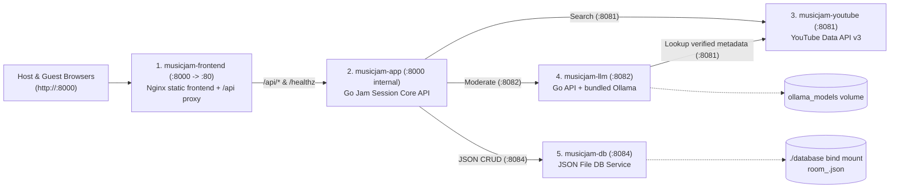

# Music Jam — Current Project State (Handoff Document)

*Generated: 2026-11-27*

This document captures the exact current architecture, container layout, codebase structure, APIs, implemented features, and verification status so work can continue smoothly in a new chat.

---

## 1. Architecture Overview (5 Docker Containers)

The application is split into **5 Docker services** in [`docker-compose.yml`](../docker-compose.yml):



| Container | Build Context | Port Mapping | Responsibility |
| :--- | :--- | :--- | :--- |
| **`musicjam-frontend`** | [`frontend/`](../frontend) ([`Dockerfile`](../frontend/Dockerfile), [`nginx.conf`](../frontend/nginx.conf)) | `0.0.0.0:8000:80` | Serves HTML/CSS/JS static files with Nginx and proxies `/api/*` and `/healthz` to `http://app:8000` (forwarding `Host`, `X-Forwarded-Host`, `X-Forwarded-Proto`). |
| **`musicjam-app`** | Root [`.`](../Dockerfile) (`backend/` + `backend/room/`) | internal `8000` | Pure Go API server (no bundled frontend or local DB mount in Docker). Manages rooms, members, host checks, cookies/sessions, ordered queue, skip logic, and orchestration between `youtube` (search), `llm` (moderation), and `db` (persistence). |
| **`musicjam-youtube`** | [`backend/YouTube/`](../backend/YouTube) | `8081:8081` | Holds `YOUTUBE_API_KEY`, calls YouTube `search.list` + `videos.list`, filters non-embeddable / `ytAgeRestricted` / geo-blocked tracks, ranks embed-safe uploads first, and serves verified metadata on `/lookup` (consumed by `musicjam-llm`). |
| **`musicjam-llm`** | [`backend/LLM/`](../backend/LLM) | `8082:8082` | Combines the Go moderation service and `ollama serve` (on `127.0.0.1:11434`) inside one `ollama/ollama:latest` container via [`entrypoint.sh`](../backend/LLM/entrypoint.sh). Calls `musicjam-youtube` (`YOUTUBE_URL=http://youtube:8081`, `GET /lookup`) for authoritative song metadata before classifying with `qwen3:4b`. |
| **`musicjam-db`** | [`backend/Database/`](../backend/Database) | `8084:8084` | Owns `./database:/app/database` and persists each room as `room_<uuid>.json` atomically over HTTP (`GET/PUT/DELETE /rooms`). |

> [!NOTE]
> **Player folded back into Core:** The former `backend/Player/` microservice and `/api/player/fallback` endpoint were removed. YouTube IFrame playback and automatic copyright-error skipping live directly in [`frontend/js/player.js`](../frontend/js/player.js) + [`frontend/js/host.js`](../frontend/js/host.js), calling Core's host-only `POST /api/room/skip` endpoint.

---

## 2. Repository Structure

```text
.
├── Dockerfile                     # Builds musicjam-app (API-only Go binary)
├── docker-compose.yml             # Orchestrates frontend, app, youtube, llm, db
├── .dockerignore
├── .env                           # Local secrets (YOUTUBE_API_KEY, optional HOST_IP / PUBLIC_ORIGIN)
├── database/                      # Persisted room_<uuid>.json files (mounted into musicjam-db)
├── frontend/                      # musicjam-frontend service
│   ├── Dockerfile
│   ├── nginx.conf
│   ├── index.html / join.html / host.html / guest.html / offline.html
│   ├── css/style.css
│   └── js/
│       ├── api.js                 # fetchWithTimeout, OfflineError, loadSessionWithRetry
│       ├── room.js                # Start page logic (host jam creation)
│       ├── join.js                # Guest join page via QR code UUID
│       ├── host.js                # Host dashboard polling, QR origin, skip/advance calls
│       ├── player.js              # YT.Player adapter, Skip button, auto-skip on embed/copyright errors
│       ├── guest.js               # Guest dashboard polling & QR invite
│       ├── queue.js               # Shared queue renderer
│       ├── members.js             # Host guest-list & remove controls
│       ├── moderation.js          # Request status & host approve/reject UI
│       ├── song-search.js         # Search & request submission UI
│       └── offline.js             # Reconnection loop
├── backend/
│   ├── go.mod
│   ├── main.go                    # Startup, DB_URL store setup, session reload, GetLocalIP & getJoinOrigin
│   ├── handlers.go                # HTTP routes: rooms, queue, /api/room/skip, moderation, session
│   ├── clients.go                 # HTTP clients for LLM (:8082) and YouTube (:8081)
│   ├── handlers_test.go           # Unit tests for rooms, host-only skip, LAN IP origin, moderation
│   ├── room/                      # Core domain package (compiled into musicjam-app)
│   │   ├── room.go                # Room struct, Add/RemoveMember, SkipCurrentSong, JSON encode/decode
│   │   ├── structs.go             # Song, Member, errors, validation helpers
│   │   ├── requests.go            # Genre list, SongRequest admission & ReleaseApproved
│   │   ├── store.go               # DB_URL remote JSON store client + local DataDir fallback
│   │   └── room_test.go           # Unit tests including remote DB round-trip
│   ├── Database/                  # musicjam-db microservice (JSON files)
│   │   ├── go.mod / Dockerfile / main.go / main_test.go
│   ├── LLM/                       # musicjam-llm microservice (Go + Ollama)
│   │   ├── go.mod / Dockerfile / entrypoint.sh / main.go / main_test.go
│   └── YouTube/                   # musicjam-youtube microservice
│       ├── go.mod / Dockerfile / main.go / main_test.go
└── documentation/
    ├── CURRENT_STATE.md           # This file
    ├── NGINX_ROUTER_PLAN.md       # Future Nginx routing & TLS enhancements
    └── checkpoint1..3/            # Domain & bounded context diagrams
```

---

## 3. Recently Implemented Behavior

1. **Host-Only Skip Button & Copyright Auto-Skip:**
   - Backend: `POST /api/room/skip` ([`backend/handlers.go`](../backend/handlers.go)) enforces `currentHost` (`401` unauthenticated, `403 Forbidden` for guests) and calls `rm.SkipCurrentSong(songID)` ([`backend/room/room.go`](../backend/room/room.go)), returning `409 Conflict` if `queue[0]` already changed so duplicate/delayed events cannot skip the next song.
   - Frontend: [`frontend/host.html`](../frontend/host.html) renders `#skip-song` whenever a song is queued. [`frontend/js/player.js`](../frontend/js/player.js) skips automatically via `POST /api/room/skip` if YouTube throws embed/copyright errors (`101`, `150`, `153`, `100`) or stalls dropping from `BUFFERING` back to `UNSTARTED`.
2. **LAN IP Access & QR Code URL:**
   - `musicjam-frontend` binds `0.0.0.0:8000:80` and forwards `X-Forwarded-Host` / `Host`.
   - `getJoinOrigin(r)` in [`backend/main.go`](../backend/main.go) resolves the QR code URL using:
     1. Non-loopback `PUBLIC_ORIGIN`
     2. Non-loopback `HOST_IP`
     3. Non-loopback request `X-Forwarded-Host` / `Host` (when opened via `http://<YOUR_LAN_IP>:8000`)
     4. Auto-detected LAN IPv4 via `GetLocalIP()` when running outside Docker
   - [`frontend/js/host.js`](../frontend/js/host.js) and [`frontend/js/guest.js`](../frontend/js/guest.js) also fall back to `location.origin` if opened on a LAN IP and the backend returned a loopback URL.
3. **JSON-File Database Microservice (`musicjam-db`):**
   - `GET /rooms`, `GET /rooms/{code}`, `PUT /rooms/{code}`, `DELETE /rooms/{code}`, `GET /healthz`.
   - Stores the exact `database/room_<uuid>.json` schema atomically (`*.tmp` + rename).
   - When `DB_URL` is unset (e.g. `go test ./...` or running natively without Docker), `backend/room` falls back to reading/writing `DataDir` (`../database`) directly.

---

## 4. Environment Variables & How to Run

### Docker (Recommended — all 5 containers)
```bash
# Ensure .env contains YOUTUBE_API_KEY=...
# Optional: set HOST_IP=192.168.x.x if the host browser uses http://localhost:8000
docker compose up --build -d
```
Open `http://<YOUR_LAN_IP>:8000` in the host browser.

### Local Go Development (without Docker)
- `backend/YouTube` (`:8081`, needs `YOUTUBE_API_KEY`)
- `backend/LLM` (`:8082`, needs local `ollama serve`)
- `backend/Database` (`:8084`, optional — if `DB_URL` is unset, `backend` reads/writes `../database` directly)
- `backend` (`:8000`, serves `../frontend` automatically if present)

---

## 5. Verification Status (Last Checked: 2026-11-27)

All unit tests, Go builds, and frontend JS syntax checks were verified locally (note: Docker daemon was not running in this environment, so `docker compose up --build` still needs to be run on the host):
- `backend/` & `backend/room/`: `go test -v ./...` and `go build` **PASS**
- `backend/Database/`: `go test -v ./...` and `go build` **PASS**
- `backend/LLM/`: `go test -v ./...` and `go build` **PASS**
- `backend/YouTube/`: `go test -v ./...` and `go build` **PASS**
- `frontend/js/*.js`: `node --check` **PASS**

---

## 6. Pending / Next Steps for New Chat

1. **Test full Docker stack on host:** Run `docker compose up --build -d` and verify:
   - All 5 containers start cleanly (`docker ps`: `musicjam-frontend`, `musicjam-app`, `musicjam-youtube`, `musicjam-llm`, `musicjam-db`).
   - Creating a room writes `database/room_<uuid>.json` via `musicjam-db`.
   - Restarting `musicjam-app` restores rooms and active sessions from `musicjam-db`.
   - Skipping a song via the **Skip song** button and auto-skipping a copyright-restricted video work in a real browser.
   - `musicjam-llm` auto-pulls `qwen3:4b` and moderates genre-filtered song requests.
2. **Optional security/cleanup polish:**
   - Remove host `ports:` from `youtube` (`8081`), `llm` (`8082`), and `db` (`8084`) in `docker-compose.yml` once verified so only `musicjam-frontend` (`:8000`) is exposed.
   - Wire "End session" on [`frontend/js/host.js`](../frontend/js/host.js) to delete the room via Core → `DELETE /rooms/{code}` on `musicjam-db`.
   - Update [`documentation/checkpoint3/musicjam-bounded-contexts.drawio`](checkpoint3/musicjam-bounded-contexts.drawio) if diagrams should match the new 5-container layout (Frontend, Core, YouTube, LLM+Ollama, JSON DB).
