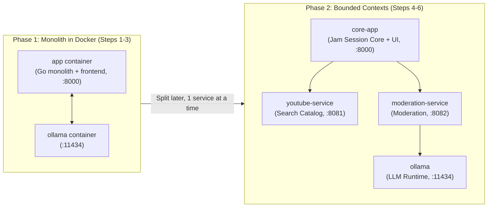

# Docker Migration & Bounded Context Separation (Baby Steps)

This guide breaks the Docker migration into **two simple phases** so you do not have to refactor your whole codebase at once:

1. **Phase 1 (Baby Steps 1–3): Put your whole existing app in Docker first.**
   You keep your single Go monolith (`package main`), change only a few config lines, and get MusicJam + Ollama running in Docker.
2. **Phase 2 (Baby Steps 4–6): Split into Bounded Contexts later, one container at a time.**
   Once Docker works comfortably, you extract `youtube-service` and `moderation-service` aligned with [`musicjam-bounded-contexts.drawio`](checkpoint3/musicjam-bounded-contexts.drawio).



---

## Phase 1: Migrate the Whole Application to Docker (Monolith)

At the end of Phase 1, your entire application runs in Docker with **zero architectural changes** to how your Go code is structured.

---

### Baby Step 1: Make Paths & QR Code IP Configurable in Go (No Docker Yet)

Right now, three hardcoded assumptions in Go work locally with `go run .`, but will cause trouble inside Docker:
- `../database` and `../frontend` are relative paths from `backend/`. Inside a container, files usually live in `/app/database` and `/app/frontend`.
- [`GetLocalIP()`](../backend/main.go#L85-L94) returns the machine's IP. Inside Docker, that returns an internal container IP (`172.x.x.x`) that phones cannot reach when scanning the QR code.

#### What to change

**1. In [`backend/main.go`](../backend/main.go):**
- Read `DATA_DIR` from the environment (fall back to `"../database"` when running locally):
  ```go
  dataDir := os.Getenv("DATA_DIR")
  if dataDir == "" {
  	dataDir = "../database"
  }
  room.DataDir = dataDir
  _ = os.MkdirAll(room.DataDir, 0755)
  rooms = room.LoadExistingRoomsFromDatabase(room.DataDir)
  ```
- Add a tiny helper so Docker/production can override the QR code URL with `PUBLIC_ORIGIN`:
  ```go
  func getJoinOrigin() string {
  	if origin := strings.TrimRight(os.Getenv("PUBLIC_ORIGIN"), "/"); origin != "" {
  		return origin
  	}
  	return "http://" + GetLocalIP().String() + ":8000"
  }
  ```

**2. In [`backend/handlers.go`](../backend/handlers.go):**
- In [`registerHandlers`](../backend/handlers.go#L15-L27), read `FRONTEND_DIR` (fall back to `"../frontend"`):
  ```go
  frontendDir := os.Getenv("FRONTEND_DIR")
  if frontendDir == "" {
  	frontendDir = "../frontend"
  }
  mux.Handle("/", http.FileServer(http.Dir(frontendDir)))
  ```
- In [`getSession`](../backend/handlers.go#L235), replace `"joinOrigin": "http://" + GetLocalIP().String() + ":8000"` with:
  ```go
  "joinOrigin": getJoinOrigin(),
  ```

#### Verify Baby Step 1
Run your tests and app locally just like before to confirm nothing broke:
```bash
cd backend
go test ./...
go run .
```

---

### Baby Step 2: Put the Whole App into a Single Docker Container (`Dockerfile`)

Before involving multiple containers, build and run your Go server + static frontend in **one** container.

#### What to create

**1. Create `.dockerignore` in the project root:**
This prevents local room JSON files, `.env` secrets, and `.git` history from being baked into the Docker image.
```dockerignore
.git
.gitignore
.env
database/
documentation/
*.md
```

**2. Create `Dockerfile` in the project root:**
This uses two stages: Stage 1 compiles the Go binary, and Stage 2 copies only the compiled binary and `frontend/` into a tiny Alpine Linux image.
```dockerfile
# Stage 1: Build the Go monolith
FROM golang:1.26-alpine AS builder
WORKDIR /src/backend
COPY backend/go.mod backend/go.sum* ./
RUN go mod download
COPY backend/ ./
RUN CGO_ENABLED=0 GOOS=linux go build -o /out/musicjam .

# Stage 2: Minimal runtime image
FROM alpine:3.21
RUN apk add --no-cache ca-certificates
WORKDIR /app
COPY --from=builder /out/musicjam /app/musicjam
COPY frontend/ /app/frontend/
RUN mkdir -p /app/database

ENV FRONTEND_DIR=/app/frontend \
    DATA_DIR=/app/database

EXPOSE 8000
CMD ["/app/musicjam"]
```

#### Verify Baby Step 2
Build and run the container from the project root:
```bash
docker build -t musicjam .
docker run --rm -p 8000:8000 --env-file .env -e PUBLIC_ORIGIN=http://localhost:8000 musicjam
```
Open `http://localhost:8000` in your browser and create a room to verify the UI and backend work inside Docker. *(Note: AI genre filtering will fall back to host `review` until Ollama is connected in Baby Step 3.)*

---

### Baby Step 3: Add `docker-compose.yml` (Persistent Rooms + Ollama)

Now run your `app` container alongside an `ollama` container using Docker Compose, and mount `./database` so your room JSON files are not lost when the container restarts.

#### What to create

Create `docker-compose.yml` in the project root:
```yaml
services:
  app:
    build: .
    container_name: musicjam-app
    ports:
      - "8000:8000"
    env_file:
      - .env
    environment:
      - FRONTEND_DIR=/app/frontend
      - DATA_DIR=/app/database
      - OLLAMA_URL=http://ollama:11434
      - PUBLIC_ORIGIN=${PUBLIC_ORIGIN:-http://localhost:8000}
    volumes:
      - ./database:/app/database
    depends_on:
      - ollama
    restart: unless-stopped

  ollama:
    image: ollama/ollama:latest
    container_name: musicjam-ollama
    volumes:
      - ollama_models:/root/.ollama
    restart: unless-stopped

volumes:
  ollama_models:
```

> [!TIP]
> **Testing QR codes with your phone on Wi-Fi:** Set `PUBLIC_ORIGIN=http://<YOUR_LAN_IP>:8000` in your shell or `.env` (for example `PUBLIC_ORIGIN=http://192.168.1.42:8000`) before starting Compose so phones scan your real laptop IP instead of `localhost`.

#### Verify Baby Step 3
Start both containers and pull the model once (stored in `ollama_models` so it persists across restarts):
```bash
docker compose up -d --build
docker compose exec ollama ollama pull qwen3:4b
```
Test creating a room with a genre filter (e.g., `Rock`), searching for a song, and restarting `docker compose restart app` to confirm the room survives via `./database`.

> [!NOTE]
> **Milestone reached!** At the end of Baby Step 3, your whole application is 100% migrated to Docker. You can stop here and use it as long as you want before moving on to Phase 2.

---

## Phase 2: Split Into Bounded Contexts Later (One Service at a Time)

Once your monolith runs smoothly in Docker, you can separate the bounded contexts from [`musicjam-bounded-contexts.drawio`](checkpoint3/musicjam-bounded-contexts.drawio) one container at a time.

**The secret to keeping Phase 2 easy:** Keep environment-variable fallbacks (`YOUTUBE_SERVICE_URL` and `MODERATION_SERVICE_URL`) inside the main app:
- If the env var is **empty** (like during `go test ./...` or `go run .`), the main app runs the local Go function directly—so **your existing tests keep passing unchanged**.
- If the env var is **set** (in `docker-compose.yml`), the main app forwards the work over HTTP to the separate container.

---

### Baby Step 4: Extract the `Search Catalog` Context (`youtube-service`)

**Goal:** Isolate `YOUTUBE_API_KEY` and the `trustedSongs` metadata cache ([`backend/youtube.go`](../backend/youtube.go)) into its own container on port `8081`.

#### How to do it
1. **Create `backend/cmd/youtube/main.go`** (moving shared YouTube API + cache functions from [`backend/youtube.go`](../backend/youtube.go) into a small `backend/catalog` package so both the fallback and the new service can call them) exposing two internal endpoints on `:8081`:
   - `GET /internal/youtube/search?q=<query>` → calls YouTube `search.list`, caches songs in `trustedSongs`, returns `[]searchResult` JSON.
   - `GET /internal/youtube/lookup?id=<videoId>` → calls `lookupYouTubeSong`, returns verified `room.Song` JSON (or `502` on failure).
2. **In [`backend/youtube.go`](../backend/youtube.go), forward when `YOUTUBE_SERVICE_URL` is set:**
   ```go
   // In handleYouTubeSearch:
   if base := strings.TrimRight(os.Getenv("YOUTUBE_SERVICE_URL"), "/"); base != "" {
   	q := r.URL.Query().Get("q")
   	if q == "" {
   		http.Error(w, "missing query", http.StatusBadRequest)
   		return
   	}
   	resp, err := youtubeClient.Get(base + "/internal/youtube/search?q=" + url.QueryEscape(q))
   	if err != nil {
   		http.Error(w, "youtube service unavailable", http.StatusBadGateway)
   		return
   	}
   	defer resp.Body.Close()
   	w.Header().Set("Content-Type", "application/json")
   	w.WriteHeader(resp.StatusCode)
   	io.Copy(w, resp.Body)
   	return
   }
   ```
   And similarly at the top of `lookupYouTubeSong`:
   ```go
   if base := strings.TrimRight(os.Getenv("YOUTUBE_SERVICE_URL"), "/"); base != "" {
   	req, err := http.NewRequestWithContext(ctx, http.MethodGet, base+"/internal/youtube/lookup?id="+url.QueryEscape(videoID), nil)
   	if err != nil {
   		return room.Song{}, err
   	}
   	resp, err := youtubeClient.Do(req)
   	if err != nil {
   		return room.Song{}, err
   	}
   	defer resp.Body.Close()
   	if resp.StatusCode != http.StatusOK {
   		return room.Song{}, errors.New("video verification failed")
   	}
   	var song room.Song
   	err = json.NewDecoder(resp.Body).Decode(&song)
   	return song, err
   }
   ```
3. **Update `Dockerfile` and `docker-compose.yml`:**
   - Add a `RUN CGO_ENABLED=0 GOOS=linux go build -o /out/youtube-service ./cmd/youtube` line and a small `youtube-service` stage to `Dockerfile`.
   - Add `youtube-service` to `docker-compose.yml` with `YOUTUBE_API_KEY` from `.env`, pass `YOUTUBE_SERVICE_URL=http://youtube-service:8081` to `app`, and remove `YOUTUBE_API_KEY` from `app` (now only `youtube-service` holds the API key).

#### Verify Baby Step 4
```bash
cd backend && go test ./...
cd .. && docker compose up -d --build
```
Search for a song in the UI and add it to a room queue to verify `app` talks to `youtube-service`.

---

### Baby Step 5: Extract the `Moderation` Context (`moderation-service`)

**Goal:** Isolate the AI prompt, JSON schema validation, concurrency slots (`slots`), and 30-minute verdict cache ([`backend/moderation.go`](../backend/moderation.go)) into its own container on port `8082`.

#### How to do it
1. **Create `backend/cmd/moderation/main.go`** (calling shared `ollamaClassifier` logic moved into e.g. `backend/ai`) exposing on `:8082`:
   - `POST /internal/moderation/classify` — accepts `{"song": {...}, "genre": "..."}` and returns `{"decision": "allow|review|block", "reason": "..."}`.
2. **Add a `remoteClassifier` in [`backend/moderation.go`](../backend/moderation.go):**
   Because [`handlers_moderation.go`](../backend/handlers_moderation.go#L14) already uses the `songClassifier` interface (`var classifier songClassifier = newClassifier()`), you only need one small struct:
   ```go
   type remoteClassifier struct {
   	endpoint string
   	client   *http.Client
   }

   func newClassifier() songClassifier {
   	if base := strings.TrimRight(os.Getenv("MODERATION_SERVICE_URL"), "/"); base != "" {
   		return &remoteClassifier{
   			endpoint: base,
   			client:   &http.Client{Timeout: 90 * time.Second},
   		}
   	}
   	return newOllamaClassifier()
   }

   func (rc *remoteClassifier) Classify(ctx context.Context, song room.Song, genre string) (verdict, error) {
   	body, _ := json.Marshal(map[string]any{"song": song, "genre": genre})
   	req, err := http.NewRequestWithContext(ctx, http.MethodPost, rc.endpoint+"/internal/moderation/classify", bytes.NewReader(body))
   	if err != nil {
   		return verdict{}, err
   	}
   	req.Header.Set("Content-Type", "application/json")
   	resp, err := rc.client.Do(req)
   	if err != nil {
   		return verdict{}, err
   	}
   	defer resp.Body.Close()
   	if resp.StatusCode != http.StatusOK {
   		return verdict{}, fmt.Errorf("moderation service status %d", resp.StatusCode)
   	}
   	var v verdict
   	err = json.NewDecoder(resp.Body).Decode(&v)
   	return v, err
   }
   ```
3. **Update `Dockerfile` and `docker-compose.yml`:**
   - Build `./cmd/moderation` into `/out/moderation-service` in `Dockerfile`.
   - Add `moderation-service` to `docker-compose.yml` with `OLLAMA_URL=http://ollama:11434` and `OLLAMA_MODEL=${OLLAMA_MODEL:-qwen3:4b}`.
   - Set `MODERATION_SERVICE_URL=http://moderation-service:8082` on `app` (and remove `OLLAMA_URL` from `app`).

#### Verify Baby Step 5
```bash
cd backend && go test ./...
cd .. && docker compose up -d --build
```
Create a room with a genre filter (for example `Rock`) and request a song to verify `app` → `moderation-service` → `ollama` works end to end.

---

### Baby Step 6 (Optional Final Polish): Isolated Docker Networks & `/healthz`

Once all 4 containers work together, harden the setup:

1. **Add `GET /healthz` to each Go service:**
   ```go
   mux.HandleFunc("/healthz", func(w http.ResponseWriter, r *http.Request) {
   	w.WriteHeader(http.StatusOK)
   })
   ```
   Then add `healthcheck:` blocks in `docker-compose.yml` and `depends_on: ... condition: service_healthy`.
2. **Isolate networks in `docker-compose.yml`:**
   - `frontend-net`: `core-app` only (exposed on `:8000`).
   - `backend-net`: `core-app`, `youtube-service`, `moderation-service`.
   - `llm-net` (`internal: true` after pulling the model): `moderation-service` and `ollama` only, so neither `core-app` nor `youtube-service` can talk directly to Ollama.

> [!TIP]
> **Later, before public cloud deployment:** Put an HTTPS reverse proxy (like Caddy or Nginx) in front of `:8000` (required for YouTube embeds and `Secure` cookies), set `PUBLIC_ORIGIN=https://yourdomain.com`, add `SIGTERM` graceful shutdown, keep `core-app` at `replicas: 1` while room state lives in memory/JSON, and add search caching + inactive room cleanup.

---

## Quick Progress Checklist

- [ ] **Baby Step 1:** Make `DATA_DIR`, `FRONTEND_DIR`, and `PUBLIC_ORIGIN` configurable in Go (`go test ./...` passes).
- [ ] **Baby Step 2:** Add `.dockerignore` and `Dockerfile`, and run the monolith in a single Docker container.
- [ ] **Baby Step 3:** Add `docker-compose.yml` (`app` + `ollama` + `./database` volume) and pull `qwen3:4b`. *(Whole app is now in Docker!)*
- [ ] **Baby Step 4:** Extract `youtube-service` (`Search Catalog` bounded context).
- [ ] **Baby Step 5:** Extract `moderation-service` (`Moderation` bounded context).
- [ ] **Baby Step 6:** Add `/healthz` endpoints and split Docker networks (`frontend-net`, `backend-net`, `llm-net`).
