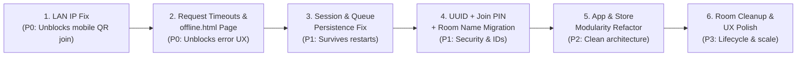

# Master Implementation Plan (Prioritized by Urgency)

This document consolidates all planned fixes and architectural improvements across the project ([`SESSION_LOSS_ON_RESTART.md`](SESSION_LOSS_ON_RESTART.md), [`MODULARITY_AND_AVAILABILITY_REVIEW.md`](MODULARITY_AND_AVAILABILITY_REVIEW.md), [`ROOM_UUID_MIGRATION_PLAN.md`](ROOM_UUID_MIGRATION_PLAN.md), [`ROOM_CODE_PROPOSALS.md`](ROOM_CODE_PROPOSALS.md), and [`KNOWLEDGE_BASE.md`](../KNOWLEDGE_BASE.md)) together with two critical operational requirements:
1. **Migrating from `localhost` to LAN IP** so mobile guests can actually join via QR code or link on the local network.
2. **Request timeouts and a dedicated Connection Error / Offline page** when the server or connection is unreachable.

---

## 0. Current Progress & What Is Left To Do

### Completed Today
- [x] **Phase 1 — LAN IP Migration (Done)**:
  - Implemented [`GetLocalIP()`](../backend/main.go#L46-L55) in [`backend/main.go`](../backend/main.go) using UDP dial (`net.Dial("udp", "8.8.8.8:80")`) with `net.IPv4(127, 0, 0, 1)` fallback.
  - Added `"joinOrigin": "http://" + GetLocalIP().String() + ":8000"` to [`getSession`](../backend/handlers.go#L230-L238) in [`backend/handlers.go`](../backend/handlers.go).
  - Updated [`frontend/js/host.js`](../frontend/js/host.js#L50-L60) to build the QR code and join URL from `session.joinOrigin`.
- [x] **Phase 2 — Request Timeouts & Connection Error Page (Done)**:
  - Configured `&http.Server{}` with `ReadHeaderTimeout: 5s`, `ReadTimeout: 10s`, `WriteTimeout: 10s` in [`backend/main.go`](../backend/main.go#L31-L37).
  - Created [`frontend/js/api.js`](../frontend/js/api.js) with `fetchWithTimeout()`, `OfflineError`, `loadSessionWithRetry()`, and `setConnectionState()`.
  - Created [`frontend/offline.html`](../frontend/offline.html) and [`frontend/js/offline.js`](../frontend/js/offline.js) with timeout/offline messaging, Wi-Fi checklist, manual retry button, and 5s auto-reconnect loop.
  - Wired request timeouts and connection status pills into [`index.html`](../frontend/index.html), [`room.js`](../frontend/js/room.js), [`host.html`](../frontend/host.html), [`host.js`](../frontend/js/host.js), [`guest.html`](../frontend/guest.html), [`guest.js`](../frontend/js/guest.js), [`members.js`](../frontend/js/members.js), and [`song-search.js`](../frontend/js/song-search.js).
- [x] **Task 3 — Worker Panic Recovery (Done)**:
  - Added `defer func() { if r := recover(); r != nil { ... } }()` at the start of [`processSongRequests`](../backend/handlers_moderation.go#L102-L111) in [`backend/handlers_moderation.go`](../backend/handlers_moderation.go).
- [x] **Phase 3 (Task 4) — Session & Room Persistence Fixes (Done)**:
  - Created [`backend/sessions.go`](../backend/sessions.go) (`saveSessions` / `loadSessions` with `../database/sessions.json`) and wired it into [`backend/main.go`](../backend/main.go#L32) and [`backend/handlers.go`](../backend/handlers.go).
  - Updated [`LoadExistingRoomsFromDatabase`](../backend/room/room.go#L194-L266) in [`backend/room/room.go`](../backend/room/room.go) to only read `room_*.json`, restore `Member.UserID` from the map key, persist `Requests` and `Name`, and save on queue/request updates (`rm.Save()`).
  - Added 24h `MaxAge` and `SameSiteLaxMode` to the `userId` cookie in [`getUserID`](../backend/handlers.go#L30-L49).
- [x] **Phase 4 (Task 5) — Pure UUID v4 + QR Code Join Migration (Done)**:
  - Replaced `math/rand/v2` 6-character room codes with `crypto/rand` RFC 4122 UUID v4 ([`GenerateUUIDv4()`](../backend/room/room.go#L112-L122)) for Room IDs, Member IDs, Song IDs, and User IDs.
  - Added human-readable Room Names ([`CleanRoomName`](../backend/room/structs.go#L51-L61)) displayed in host and guest headers.
  - Removed manual room code entry from [`frontend/index.html`](../frontend/index.html), [`frontend/js/room.js`](../frontend/js/room.js), [`frontend/host.html`](../frontend/host.html), [`frontend/js/host.js`](../frontend/js/host.js), [`frontend/guest.html`](../frontend/guest.html), and [`frontend/js/guest.js`](../frontend/js/guest.js) — guests now join exclusively via the QR code / UUID link (`/?join=<uuid>`).

### Optional Future Tasks (Phase 5 & 6)
- Refactor globals into `App` struct (`backend/app.go`) & `store` package (`backend/store/`).
- Add `DELETE /api/room` so "End session" deletes the room on the server.

---

## 1. Urgency Overview Matrix

| Priority | Phase | Focus Area | Why This Urgency? | Effort |
| :--- | :--- | :--- | :--- | :--- |
| **P0 — Critical (Immediate)** | **Phase 1** | **LAN IP instead of `localhost`** | **Blocker for multi-device use:** QR codes currently encode `http://localhost:8080`, which points a guest's phone to itself instead of the host laptop. | S (½ day) |
| **P0 — Critical (Immediate)** | **Phase 2** | **Request Timeouts & Offline / Connection Error Page** | **Blocker for reliability & UX:** Unreachable IPs or hung requests leave users on blank/frozen screens with no timeout and no error page. | M (1 day) |
| **P1 — High (Next)** | **Phase 3** | **Session & Queue Persistence Fixes on Restart** | **Core state bug:** Server restarts wipe `sessions`, fail to save queue/requests, and break member kicking (`Member.UserID` lost). | M (1 day) |
| **P1 — High (Next)** | **Phase 4** | **UUID Migration (Rooms & Members + Room Names)** | **Architecture & Security:** Replaces predictable `math/rand/v2` 6-char primary keys with UUID v4 while keeping a 6-char Join PIN + QR code. | M (1–2 days) |
| **P2 — Medium** | **Phase 5** | **Modularity Refactoring (`App`, `store`, Worker Recovery)** | **Testability & Code Health:** Eliminates package globals, stops `go test` from polluting `database/`, and prevents worker panics from crashing the server. | M (1–2 days) |
| **P3 — Low (Future)** | **Phase 6** | **Room Cleanup, Name Entry Polish & Scaling** | **Polish & Horizontal Scale:** `DELETE /api/room` on "End session", 24h TTL cleanup, SSE, and Redis multi-server support. | L (2+ days) |

---

## 2. Detailed Plan by Urgency

### Phase 1 (P0 — Immediate): Migrate from `localhost` to LAN IP

#### The Problem Today
1. [`backend/main.go`](../backend/main.go#L27-L28) logs `MusicJam listening on http://localhost:8080` and [`README.md`](../README.md#L70) instructs the host to open `http://localhost:8080`.
2. [`frontend/js/host.js`](../frontend/js/host.js#L44) constructs the QR code URL from `location.origin + "/?join=" + code`.
3. When the host opens `http://localhost:8080`, the QR code contains `http://localhost:8080/?join=CODE`. Any guest scanning that QR code on their phone tries to connect to `localhost` (their own phone) and the connection fails immediately.
4. Additionally, if the host opens `localhost:8080`, their `userId` cookie is scoped to `localhost`, whereas if they switch to `192.168.x.x:8080`, the browser treats it as a different origin.

#### Implementation Steps
1. **Detect LAN IPv4 in Backend (`backend/main.go` / `backend/network.go`)**:
   - Write a helper `detectLANIP() string` that:
     - Checks an optional `HOST_IP` or `PUBLIC_URL` environment variable first.
     - Uses a UDP dial (`net.Dial("udp", "8.8.8.8:80")`) or iterates `net.InterfaceAddrs()` to find the primary non-loopback IPv4 address (e.g. `192.168.1.42`).
     - Falls back to `127.0.0.1` only if offline with no LAN interface.
2. **Bind & Log LAN IP at Startup (`backend/main.go`)**:
   - Listen on `0.0.0.0:8080` (`":8080"`).
   - Log the exact LAN URL clearly at startup:
     ```text
     MusicJam listening on:
       Local:   http://localhost:8080
       Network: http://192.168.1.42:8080  <-- Open this URL to host!
     ```
3. **Auto-Redirect `localhost` to LAN IP or Return `joinOrigin` in `/api/session`**:
   - **Option A (Recommended — Redirect `localhost` to LAN IP)**: Middleware checks if `r.Host` starts with `localhost:` or `127.0.0.1:` when a LAN IP is available, and redirects (`302`) the host browser straight to `http://<LAN_IP>:8080`. This guarantees both the host's cookie (`userId`) and `location.origin` (used by `host.js` for the QR code and YouTube IFrame `origin`) use the LAN IP.
   - **Option B (Defense in depth in `getSession`)**: Include `"joinOrigin": "http://<LAN_IP>:8080"` in `GET /api/session` ([`backend/handlers.go`](../backend/handlers.go#L192-L211)) and use `session.joinOrigin || location.origin` in [`frontend/js/host.js`](../frontend/js/host.js#L44) when rendering `#qr-code` and `#join-url`.

---

### Phase 2 (P0 — Immediate): Request Timeouts & Dedicated Connection Error Page

#### The Problem Today
1. **No Frontend Fetch Timeouts**: Every `fetch()` in [`room.js`](../frontend/js/room.js), [`host.js`](../frontend/js/host.js), [`guest.js`](../frontend/js/guest.js), [`members.js`](../frontend/js/members.js), and [`song-search.js`](../frontend/js/song-search.js) has no timeout. If a phone tries to reach a dead IP or stalled server, the browser hangs for 30–120 seconds.
2. **Unhandled Rejections on Page Load**: [`host.js` `init()`](../frontend/js/host.js#L33-L35) and [`guest.js` `init()`](../frontend/js/guest.js#L14-L16) call `await fetch("/api/session")` without `try/catch`. If the connection fails or times out, the page crashes silently in a half-loaded state.
3. **No Dedicated Offline / Connection Error Page**: Users have no clear screen explaining that the connection timed out or the server is unreachable, nor a way to retry or return home.
4. **No Backend HTTP Server Timeouts**: [`main.go`](../backend/main.go#L28) uses default `http.ListenAndServe` (no read/write/idle timeouts), and Ollama waits up to 90s ([`moderation.go`](../backend/moderation.go#L54)).

#### Implementation Steps

##### A. Frontend: Shared Fetch Wrapper with Timeouts (`frontend/js/api.js`)
Create `frontend/js/api.js` (loaded before page scripts) that enforces timeouts on every request using `AbortController` / `AbortSignal.timeout`:

```js
class OfflineError extends Error {
  constructor(message, isTimeout = false) {
    super(message);
    this.name = "OfflineError";
    this.isTimeout = isTimeout;
  }
}

async function fetchWithTimeout(url, options = {}, timeoutMs = 5000) {
  const controller = new AbortController();
  const timer = setTimeout(() => controller.abort(), timeoutMs);
  try {
    const response = await fetch(url, { ...options, signal: controller.signal });
    if (response.status >= 500) {
      throw new OfflineError(`Server error (${response.status})`, false);
    }
    return response;
  } catch (err) {
    if (err instanceof OfflineError) throw err;
    const isTimeout = err.name === "AbortError" || err.name === "TimeoutError";
    throw new OfflineError(
      isTimeout ? "Request timed out. The server took too long to respond." : "Cannot reach the Music Jam server.",
      isTimeout
    );
  } finally {
    clearTimeout(timer);
  }
}
```
- **Default timeouts**:
  - `GET /api/session`, `GET /api/genres`, `GET /api/room/requests`, `GET /api/room/getRoomMembers`: **`5000 ms` (5s)**
  - `POST /api/room/create`, `POST /api/room/join`, `POST /api/room/requests`, `DELETE /api/room/queue`: **`6000 ms` (6s)**
  - `GET /api/youtube/search`: **`10000 ms` (10s)**

##### B. Frontend: Dedicated Connection Error / Offline Page (`frontend/offline.html`)
Create [`frontend/offline.html`](../frontend/offline.html) styled consistently with [`guest.html`](../frontend/guest.html#L61-L68) and [`style.css`](../frontend/css/style.css):
- **Visual Elements**:
  - Music Jam header logo + grayed-out `.dot.offline` status pill (`Offline`).
  - Centered `.ended-icon` with a Wi-Fi / disconnected SVG icon.
  - Heading: **"Connection timed out"** (if `?reason=timeout`) or **"Can't reach Music Jam"**.
  - Helpful checklist for party guests:
    - Make sure your phone is connected to the **same Wi-Fi network** as the host.
    - Check that the host computer is still running the jam.
  - **Primary button (`#retry-btn`)**: `"Try reconnecting"` — pings `GET /api/genres` (or `/healthz`) with a 4s timeout. If successful, redirects back to the `returnTo` query parameter (e.g. `/guest.html?code=...` or `/host.html` or `/`).
  - **Auto-retry**: Polls every 5 seconds in the background and automatically returns the user to their page if the server comes back online.
  - **Secondary link**: `"Back to start page"` (`/`).

##### C. Frontend: When to Show Inline "Reconnecting…" vs. Redirect to `offline.html`
- **On `index.html` (`room.js`)**:
  - If loading genres or clicking "Start a jam" / "Join" throws `OfflineError` (timeout or network unreachable), redirect to `/offline.html?returnTo=/&reason=timeout` (or show an inline banner with a button to open the connection troubleshooting page).
- **On `host.html` (`host.js`) and `guest.html` (`guest.js`)**:
  - **Initial page load (`init()`)**: If `fetchWithTimeout("/api/session")` fails after 2 quick retries (~6s total), redirect to `/offline.html?returnTo=${encodeURIComponent(location.pathname + location.search)}&reason=timeout`.
  - **During active polling (`refresh()`)**:
    - Failures 1–3 (first ~9–12 seconds): Show `.dot.offline` + `"Reconnecting…"` in the header pill so a brief Wi-Fi blip doesn't interrupt music playback on the host.
    - If consecutive poll timeouts/failures exceed threshold (e.g., 5 consecutive failures on guest), redirect guest to `/offline.html?returnTo=...` so they aren't staring at a stale queue.

##### D. Backend: HTTP Server & External Call Timeouts (`backend/main.go`, `backend/moderation.go`)
1. **`backend/main.go`**: Replace `http.ListenAndServe` with an explicit `http.Server`:
   - `ReadHeaderTimeout: 5 * time.Second`
   - `ReadTimeout: 10 * time.Second`
   - `WriteTimeout: 15 * time.Second`
   - `IdleTimeout: 60 * time.Second`
   - Add `GET /healthz` endpoint returning `200 OK` (`{"status": "ok"}`) for fast frontend connectivity checks.
   - Add graceful shutdown via `signal.NotifyContext(context.Background(), os.Interrupt, syscall.SIGTERM)`.
2. **`backend/moderation.go` & `backend/handlers_moderation.go`**:
   - Reduce Ollama timeout from `90s` to `20s` (configurable via `AI_TIMEOUT`), falling back cleanly to `review` on timeout.

---

### Phase 3 (P1 — High): Fix Session & Room Persistence Across Restarts

Full analysis in [`SESSION_LOSS_ON_RESTART.md`](SESSION_LOSS_ON_RESTART.md).

#### Implementation Steps
1. **Persist Sessions (`backend/sessions.go`)**:
   - Save `userId -> roomCode` atomically to `database/sessions.json` whenever a room is created, joined, or a member is kicked.
   - Restore `sessions` at startup in `main.go` after loading rooms, verifying `rm.Member(userID)` still exists.
2. **Fix Persistence Bugs in `backend/room/room.go`**:
   - Restore `Member.UserID` from the map key in `LoadExistingRoomsFromDatabase` (fixes kicking guests after a restart).
   - Only load files matching `room_*.json` so `sessions.json` is not parsed as a room.
   - Do **not** persist `ProcessingRequests` (runtime-only flag); persist `Requests` alongside `NextRequest` (or reset `nextRequest` and re-trigger the worker for `Pending` requests on startup).
   - Call `saveToJsonFile` when the queue or song requests change (`submitSong`, `processSongRequests`, `decideSongRequest`, `DELETE /api/room/queue`).
3. **Harden Session Cookie (`backend/handlers.go`)**:
   - Set `MaxAge: 86400` (24h) and `SameSite: http.SameSiteLaxMode` on the `userId` cookie in `getUserID` so mobile browsers don't delete the cookie when switching apps.
4. **Git & Test Hygiene**:
   - Add `database/` to `.gitignore` and untrack any committed room JSON files.

---

### Phase 4 (P1 — High): Migrate to UUIDs (Rooms & Members) + Room Names

Full analysis in [`ROOM_UUID_MIGRATION_PLAN.md`](ROOM_UUID_MIGRATION_PLAN.md) and [`ROOM_CODE_PROPOSALS.md`](ROOM_CODE_PROPOSALS.md) (Proposal A: Dual Identifier).

#### Why After Phases 1–3?
UUID migration changes the primary key of rooms across backend structs, persistence files, sessions, API payloads, and tests. Doing it right after stabilizing persistence (or together with Phase 3's persistence format update) avoids migrating broken persistence logic twice.

#### Implementation Steps
1. **Three-Layer Room Identifier (`backend/room/room.go`)**:
   - `id string`: Canonical **UUID v4** generated via `crypto/rand` (`generateUUIDv4()`) — used for `rooms[id]`, `session.RoomID`, and `database/room_<uuid>.json`.
   - `joinCode string`: Ephemeral **6-character alphanumeric code** generated via `crypto/rand` (replacing `math/rand/v2`) — used for manual guest typing and mapped via `joinCodes[code] -> uuid`.
   - `name string`: Human-readable **Room Name** (e.g., `"Alex's Jam"`), displayed in the Host and Guest UI headers.
2. **Member UID (`backend/room/structs.go`)**:
   - Update `Member.ID` (marked `// change to UID` on line 30) and `Song.ID` to use `generateUUIDv4()`.
3. **Flexible Join & Lookup (`backend/handlers.go`)**:
   - `POST /api/room/join?code=<input>` accepts either the 36-char UUID (from QR code deep link `/?join=<uuid>`) or the 6-char `joinCode` (typed manually by a guest).
4. **Frontend Updates (`index.html`, `host.html`, `guest.html`)**:
   - Optional "Room name" input on `index.html` (defaults to `"{HostName}'s Jam"`).
   - QR code encodes `http://<LAN_IP>:8080/?join=<uuid>`, while the big display badge shows the 6-char `joinCode` for manual entry and the room's human name.

---

### Phase 5 (P2 — Medium): Modularity & Availability Refactoring

Full analysis in [`MODULARITY_AND_AVAILABILITY_REVIEW.md`](MODULARITY_AND_AVAILABILITY_REVIEW.md) and [`KNOWLEDGE_BASE.md`](../KNOWLEDGE_BASE.md).

#### Implementation Steps
1. **`App` Struct (`backend/app.go`)**:
   - Move `mu`, `rooms`, `joinCodes`, `sessions`, `store`, `classifier`, and `catalog` out of package-level globals into `type App struct`.
   - Allows isolated, parallel tests (`t.Parallel()`) and clean restart tests using `t.TempDir()`.
2. **`store` Package (`backend/store/`)**:
   - Move JSON file reading/writing out of `backend/room/room.go` into `store.FileStore` (with atomic temp-file + `Sync` + `Rename` and `DATA_DIR` configuration) and `store.Memory` for unit tests.
   - Stops `go test ./...` from writing test rooms into the real `database/` folder.
3. **Worker Panic Recovery (`backend/handlers_moderation.go`)**:
   - Add `defer recover()` inside `processSongRequests` so an unexpected panic in background moderation resets `ProcessingRequests = false` instead of crashing the whole server.
4. **Access Check & Dead Code Cleanup**:
   - Require valid session or sanitize output in `getRoomMembers`.
   - Remove unused legacy frontend files (`frontend/session.html`, `frontend/js/youtube-search.js`, `frontend/components/nav.js`) and the `legacy` flag in `submitSong`.

---

### Phase 6 (P3 — Future): Room Lifecycle Cleanup, UX Polish & Scaling

1. **Host "End Session" Endpoint (`DELETE /api/room`)**:
   - Wire the `#end-session` button in [`frontend/js/host.js`](../frontend/js/host.js#L229-L231) to `DELETE /api/room`, deleting the room from memory, disk, and clearing member sessions so guests immediately see the "Jam ended" screen.
2. **Automatic Inactive Room Cleanup**:
   - Background ticker (every 10 minutes) that deletes rooms inactive for >1 hour or older than 24 hours.
3. **Start Page Name Entry UX (`frontend/index.html`, `frontend/js/room.js`)**:
   - Remember user's name in `localStorage`, show inline server validation errors, hide the Host card when scanning a QR code (`/?join=...`), and show a "Welcome back — Continue in room" banner when `/api/session` is active.
4. **Multi-Server Scaling (Redis + SSE)**:
   - Implement `store.RedisStore` and Server-Sent Events (`text/event-stream`) as outlined in [`ROOM_CODE_PROPOSALS.md`](ROOM_CODE_PROPOSALS.md) §6–7.

---

## 3. Recommended Execution Sequence


