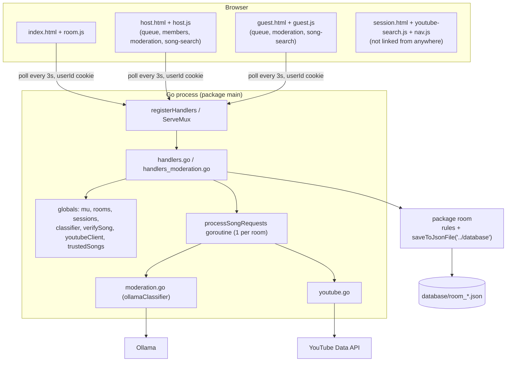
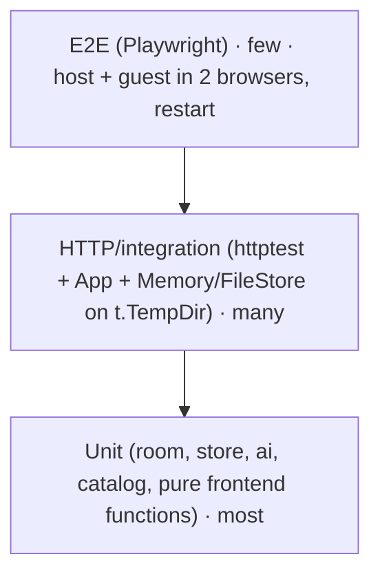

# MusicJam: modularity and availability review

**Date:** October 30, 2026 · **Code state:** `main` @ `7e3d99a` (plus the uncommitted comment in `backend/room/structs.go`)

This document checks the **current** code (not the target picture in [`KNOWLEDGE_BASE.md`](../KNOWLEDGE_BASE.md)). For each finding it says what is wrong, why it matters, and how to fix it. Section 6 explains how tests should be written from now on.

> [!NOTE]
> The restart/session bug is covered separately in [`SESSION_LOSS_ON_RESTART.md`](SESSION_LOSS_ON_RESTART.md). This review only refers to it.

---

## 0. Summary

| Area | Rating | In one sentence |
|---|---|---|
| Backend domain logic (`room` package) | 🟡 | Clear rules and a good admission order, but the package also does file I/O with a hardcoded path |
| Backend HTTP layer (`main` package) | 🟠 | Everything is a package-level global, so it can't be replaced, tested in parallel or restarted in a test |
| External services (YouTube, Ollama) | 🟢 | Timeouts, context, caches, a semaphore and a `songClassifier` interface. The best part of the code |
| Persistence | 🔴 | Rooms are saved only on member changes, sessions are never saved, and errors are ignored |
| Server operation (availability) | 🔴 | No server timeouts, no graceful shutdown, no health check, and a panic in the worker crashes the process |
| Frontend structure | 🟡 | Split into small files, but it uses global scripts, has no API layer, and contains dead legacy code |
| Frontend failure handling | 🟠 | Can't tell "offline" from "removed"; error messages stay on screen |
| Tests | 🟡 | Good handler scenarios and race-free (`go test -race` passes), but they write into the real `database/` folder, have no restart test and no frontend tests |

**Coverage today** (`go test -cover ./...`): `backend` **74.9 %**, `backend/room` **48.4 %**. 0 % for `getSession`, `getGenres`, `handleYouTubeSearch` and `main`. `getUserID` is at 28.6 %.

> [!WARNING]
> **Documentation drift:** `KNOWLEDGE_BASE.md` §1.3 and §3 say that `backend/store/`, `backend/catalog/`, `backend/ai/`, `app.go` and `room/data.go` are *implemented* ("Status October 23"). In the repo these folders are **empty** and the files don't exist. Either the work was lost or the status is wrong. Fix the status block before planning based on it.

---

## 1. Current architecture



| File | Lines | Responsibility |
|---|---|---|
| `backend/main.go` | 30 | Globals, `Session`, startup |
| `backend/handlers.go` | 254 | Routing, cookie/identity, room create/join/members/kick, session, queue |
| `backend/handlers_moderation.go` | 185 | Genres, song requests, worker, host decisions |
| `backend/moderation.go` | 141 | Ollama classifier with cache and concurrency limit |
| `backend/youtube.go` | 175 | Search handler, metadata lookup, trusted song cache |
| `backend/room/room.go` | 220 | Room, members, room code, **JSON save/load** |
| `backend/room/moderation.go` | 94 | Genres, request status, admission order |
| `backend/room/structs.go` | 48 | Song, Member, name validation, errors |
| `frontend/js/host.js` | 231 | Host page: polling, YouTube player, moderation, members |
| `frontend/js/youtube-search.js` | 246 | **Legacy** (only used by the unlinked `session.html`) |

---

## 2. Modularity: backend

### M1 🔴 Global state in `package main`

**Today:** `mu`, `rooms`, `sessions` ([main.go](../backend/main.go#L11-L14)), `classifier`, `verifySong` ([handlers_moderation.go](../backend/handlers_moderation.go#L14-L15)), `youtubeClient` and `trustedSongs` ([youtube.go](../backend/youtube.go#L110-L118)) are package variables. `newOllamaClassifier()` reads environment variables **when the package is initialized**.

**Why it hurts:**
- Every test has to swap globals and put them back (`previousRooms, previousSessions := rooms, sessions`). Tests can never use `t.Parallel()`.
- A "restart test" needs two servers on the same data. With globals there is only one.
- You can't see from a function's signature what it depends on.

**How:** follow *Milestone 0* in `KNOWLEDGE_BASE.md` §2: an `App` struct with `mu`, `rooms`, `sessions`, `store`, `classifier`, `catalog`, plus `newApp(deps)` and `(a *App) routes() http.Handler`. Handlers become methods. `main` only reads the config and wires things together.

```go
type App struct {
	mu         sync.Mutex
	rooms      map[string]*room.Room
	sessions   map[string]*Session
	store      store.Store      // FileStore in prod, Memory in tests
	classifier songClassifier   // ollama in prod, classifierFunc in tests
	catalog    catalog.Catalog  // YouTube in prod, fake in tests
}
```

### M2 🔴 The domain package does I/O with a hardcoded path

**Today:** `room.NewRoom`, `AddMember` and `RemoveMember` call `saveToJsonFile`, which writes to `"../database/room_<CODE>.json"` ([room.go](../backend/room/room.go#L149-L171)). The path is relative to **wherever the process was started**.

**Consequences:**
- Started from the repo root → files go to `../database` *outside* the project.
- **Every `go test` run writes 8 real room files into `database/`.** That's why `database/` holds many untracked `room_*.json` files.
- `room` tests (working directory `backend/room`) write to `backend/database/`, which doesn't exist, and the error is silently ignored.
- `os.WriteFile` and `os.Rename` errors are ignored, so a full disk goes unnoticed.
- File I/O happens while the global `mu` is held, so every room waits for the disk.
- `Room.mutex` is only used inside `saveToJsonFile`. All other fields are protected by the global `mu`. Two locking schemes for the same data invite mistakes.

**How:**
1. `room` gets **no I/O**: a `Data()` snapshot plus `FromData(d)` (KB §A.3).
2. A new `store` package with a `Store` interface (`SaveRoom`, `LoadRooms`, `DeleteRoom`, `SaveSessions`, `LoadSessions`), a `FileStore(dir)` and a `Memory` for tests (KB §A.4).
3. `App` calls `a.save(rm)` after **every** change: create, join, kick, queue POST/DELETE, request status, host decision. Today queue and request changes are **never** saved.
4. Make the folder configurable with `DATA_DIR` and log the absolute path at startup.
5. Remove `Room.mutex`. The global `mu` (later maybe one per room) is the only lock.

### M3 🟠 Persisting runtime state, missing persistent state

| Field | Saved today | Should be |
|---|---|---|
| `ProcessingRequests` | ✅ | ❌ **runtime only**. If `true` is saved, no worker starts after a restart (`!c.room.ProcessingRequests` is false) and pending requests hang forever |
| `nextRequest` | ✅ | ✅ but only **together with** `Requests` |
| `Requests` | ❌ | ✅ (otherwise `nextRequest` points past the end, and new requests get stuck) |
| `Member.UserID` | ❌ (only as the map key; not copied back on load) | Restore it from the key on load |
| Sessions | ❌ | ✅ (see `SESSION_LOSS_ON_RESTART.md`) |

**How:** `room.Data` contains exactly the persistent fields plus a `Version`. On load, requests that are still `Pending` are queued for the worker again (KB §A.6).

### M4 🟠 Handlers mix HTTP, identity and domain rules

- [`handlers.go`](../backend/handlers.go) contains routing, cookie creation, identity lookup, room logic and queue logic. `handleQueue` does method dispatch itself (`switch r.Method`), and `POST /api/room/queue` goes back into `submitSong(…, legacy=true)`. That **legacy path** only exists for `youtube-search.js`.
- `releaseRoomRequests` (in `main`) checks membership through `sessions` and then calls `rm.ReleaseApproved()` (in `room`). The rule "a request from someone who left the room gets blocked" is split across two packages.
- `createNewRoom` and `joinRoom` accept **any HTTP method** (also `GET`), and the name comes through the query string.

**How:**
- Go 1.22+ method routing: `mux.HandleFunc("POST /api/rooms", a.createRoom)`, `mux.HandleFunc("DELETE /api/room/queue", a.finishSong)` and so on. This removes the `switch r.Method` blocks and the `Allow` boilerplate.
- Remove the legacy path once `session.html`/`youtube-search.js` are deleted (see F2).
- Middleware for identity: `a.withCaller(handler)` and `a.withHost(handler)` instead of calling `currentCaller` by hand in every handler.
- Move the domain rule into `room`: `rm.BlockRequestsFrom(isMember func(userID) bool)`.
- JSON body instead of query parameters for name and code (KB §C.5).

### M5 🟡 External services: good, but not swappable

**Good:** the `songClassifier` interface, `classifierFunc` as a test adapter, the context timeout, the semaphore (`slots`), the cache, strict JSON parsing and treating titles as untrusted input.

**Improve:**
- `verifySong` is a function variable and `youtubeClient` is a global. Introduce a `catalog.Catalog` interface (`Search(ctx, q)`, `Lookup(ctx, videoID)`) and move `youtube.go` into `catalog/youtube.go` (KB §1.3).
- `os.Getenv` in a handler (`handleYouTubeSearch`, `lookupYouTubeSong`): read the config **once** at startup, so a missing key is visible in the startup log rather than only on the first search.
- `classifier` and `trustedSongs` caches: clearing the whole map at 512 entries is OK for now. Later, use one small TTL cache type for both.
- **Moving `moderation.go` into `ai/ollama.go`**: the `ai` package then uses its own `Input` type instead of `room.Song` (dependency rule in KB §1.1).

### M6 🟡 Smaller points

- `Session.IsHost` is stored twice (on the session *and* via `room.IsHost`). Use `rm.IsHost(userID)` only.
- `getRoomMembers` has **no access check**: anyone with a room code sees names and public member IDs. Use `currentCaller` and compare the room code.
- Typos and comments: `curentRoom`, `prenent`, `// change to UID`.
- `backend/backend` (a compiled binary) is in the working directory. Make sure it stays ignored (it is in `.gitignore`).

---

## 3. Modularity: frontend

### F1 🟠 Global scripts without an API layer

**Today:** each page loads 4–5 classic `<script>` files that share the global namespace (`renderQueue`, `showGenre`, `refresh` …). `fetch` calls with URLs are spread across `host.js`, `guest.js`, `members.js`, `song-search.js`, `room.js` and `session.html`. Cache busting is manual (`?v=1`, `?v=genre-1`).

**How:**
- **ES modules** (`<script type="module">`, `import`/`export`). No bundler needed, and name collisions go away.
- A **`js/api.js`** as the only place that knows URLs and status codes (KB §C.4):
  ```js
  export class OfflineError extends Error {}
  export class GoneError extends Error {}   // 401/404: session or room is really gone
  export async function api(path, { method = "GET", body } = {}) { /* fetch + error mapping */ }
  export const getSession = () => api("/api/session");
  export const getRoomState = () => api("/api/room/requests");
  export const finishSong = (songId) => api("/api/room/queue", { method: "DELETE", body: { songId } });
  ```
- A shared **`js/poller.js`** for the 3-second loop. `host.js` and `guest.js` each have their own copy with `refreshing`/`queueVersion` flags:
  ```js
  export function startPolling(task, { interval = 3000, onOffline, onOnline, onGone }) { … }
  ```

### F2 🟠 Dead code: `session.html`, `youtube-search.js`, `components/nav.js`

No page links to `session.html`. Together that is about **330 lines** with a *second* player and queue implementation (`renderQueue`, `playSong`, `advanceQueue` exist twice). They are also the reason the legacy path `POST /api/room/queue` exists in the backend. **Delete them** (they stay in the git history), and then remove the `legacy` path from `submitSong`.

### F3 🟡 `host.js` does too much

231 lines with ~15 module-level state variables (`player`, `playerReady`, `apiReady`, `started`, `currentSongId`, `playingSongId`, `finishedSongId`, `advancing`, `deciding`, `refreshing`, `queueVersion` …). Split it:

| Module | Contents |
|---|---|
| `player.js` | YouTube IFrame wrapper: `createPlayer(el, { onEnded, onAutoplayBlocked })`, `play(song)`. All the player flags live here |
| `host-queue.js` | `syncPlayer`/`advanceQueue` logic as a **pure function** where possible (`nextAction(queue, playerState) → "play" | "advance" | "idle"`), which is easy to test |
| `host.js` | Only wiring: session, QR code, poller, moderation, members |

### F4 🟡 Mixed DOM styles

`queue.js`, `moderation.js` and `members.js` build the DOM safely with `textContent`. `song-search.js` uses `innerHTML` for a fixed template (OK) and `youtube-search.js` uses `innerHTML` with `escapeHtml`. Rule from now on: **`textContent`/`createElement` only.** `innerHTML` only for static markup without data.

---

## 4. Availability

### 4.1 What happens when …?

| Event | Today | Target |
|---|---|---|
| Server restart (deploy, crash, Ctrl+C) | Rooms back, **sessions gone**, guests see "jam ended" | Sessions persisted, frontend shows "Reconnecting…" |
| Panic in the HTTP handler | `net/http` catches it, the `defer mu.Unlock()` releases the lock ✅ | Same |
| **Panic in `processSongRequests`** | **The whole process crashes** (goroutines outside handlers aren't recovered). If it happens while `mu` is held, nobody else can get the lock before the crash anyway | `defer recover()` in the worker; set the request to `review` and `ProcessingRequests=false` |
| Ollama down or slow | Request → `review` after at most 90 s ✅ | Shorter timeout (`AI_TIMEOUT`, e.g. 20 s), so the host doesn't wait 90 s |
| YouTube down | Search → 502, lookup → `review` ✅ | Same, plus a clear message in the UI |
| YouTube quota used up (~100 searches/day) | Search → 502 "youtube returned an error" | Cache searches (query → results, TTL), show "quota reached" |
| Disk full / not writable | Error **ignored**, data silently lost | Log it with the room code, keep serving from memory; fail fast **at startup** if `DATA_DIR` isn't writable |
| Corrupt room file | Skipped silently | Log it, rename it to `.corrupt` (KB §A.6) |
| Slow or malicious client (slowloris) | `http.ListenAndServe` without timeouts → connections are held open indefinitely | `http.Server{ReadHeaderTimeout, ReadTimeout, WriteTimeout, IdleTimeout}` |
| Redeploy on Render/Railway (`SIGTERM`) | Process ends immediately and running requests are cut off | Graceful shutdown with `signal.NotifyContext` + `srv.Shutdown(ctx)` (KB §A.7) |
| Container disk is wiped on deploy | All rooms gone | Persistent disk/volume + `DATA_DIR`, later Redis (KB §B.7) |
| CDN down (Bootstrap, qrcode.js) | No QR code on the host page and no styling | Copy `qrcode.min.js` (and Bootstrap) into `frontend/vendor/` |
| Many rooms over weeks | Rooms are **never deleted** (memory and disk keep growing); "End session" only navigates away | Cleanup per the README rules (host gone >10 min, 1 h inactive, max 24 h) + `DELETE /api/room` |
| Many requests per room | `Requests` keeps growing forever | Trim resolved requests after N entries or T minutes, and adjust `nextRequest` |

### 4.2 Fixes in order

1. **Make the server robust** (`main.go`):
   ```go
   srv := &http.Server{
       Addr: ":" + cfg.Port, Handler: app.routes(),
       ReadHeaderTimeout: 5 * time.Second, ReadTimeout: 10 * time.Second,
       WriteTimeout: 30 * time.Second, IdleTimeout: 60 * time.Second,
   }
   ctx, stop := signal.NotifyContext(context.Background(), os.Interrupt, syscall.SIGTERM)
   defer stop()
   go func() {
       if err := srv.ListenAndServe(); err != nil && !errors.Is(err, http.ErrServerClosed) {
           log.Fatal(err)
       }
   }()
   <-ctx.Done()
   shutdownCtx, cancel := context.WithTimeout(context.Background(), 10*time.Second)
   defer cancel()
   srv.Shutdown(shutdownCtx)
   ```
2. **Recover in the worker:**
   ```go
   defer func() {
       if p := recover(); p != nil {
           log.Printf("moderation worker for room %s panicked: %v", rm.Code(), p)
           mu.Lock()
           rm.ProcessingRequests = false
           mu.Unlock()
       }
   }()
   ```
3. **`GET /healthz`**: lock `mu` briefly, answer `200 ok`, and register it as the health check path on the hosting platform (KB §B.6).
4. **Persistence complete** (M2, M3) + **sessions** (`SESSION_LOSS_ON_RESTART.md`).
5. **Frontend downtime handling**: `api.js` with `OfflineError`, plus a "Reconnecting…" indicator.
6. **Limits:** `http.MaxBytesReader` also in `removeRoomMember` (today it decodes the body without a limit); a simple per-IP rate limit for `/api/youtube/search` (it uses quota).
7. **Cleanup job** (ticker every 10 min) for inactive rooms + `DELETE /api/room`.
8. **Logging:** `log/slog` with `room`, `user` (public member ID only, never the cookie) and `err` fields.

### 4.3 Scaling limits (for later)

- **One global `mu`** for all rooms. That's fine at party scale (each client polls 1–2 endpoints every 3 s). Later: one lock per room, with the global lock only for the `rooms`/`sessions` maps.
- **Polling** costs `clients × 0.33–0.66` requests/s. Later: Server-Sent Events (`text/event-stream`) for queue updates; polling stays as a fallback.
- **Only one instance** at a time (state lives in memory and in local files). Horizontal scaling only with Redis (README plan).

---

## 5. Prioritized roadmap

| Prio | Task | Effort | Section |
|---|---|---|---|
| **P0** | Persist sessions, `Member.UserID` on load, don't save `ProcessingRequests`, save `Requests` | M | M3, session doc |
| **P0** | Tests must no longer write into `database/`; `database/` into `.gitignore`, delete the test room files | S | M2, 6.2 |
| **P0** | Server timeouts, graceful shutdown, `recover` in the worker | S | 4.2 |
| **P1** | `App` struct (Milestone 0) | M | M1 |
| **P1** | `store` package + `DATA_DIR`, save after every change, log errors | M | M2 |
| **P1** | Frontend `api.js` + "Reconnecting…" + delete legacy files | M | F1, F2 |
| **P1** | Restart test + CI pipeline | S | 6 |
| **P2** | Method routing + identity middleware, JSON bodies | M | M4 |
| **P2** | `catalog` and `ai` packages, config read once | M | M5 |
| **P2** | Split `host.js` (player / pure queue logic) + ES modules | M | F3 |
| **P2** | `/healthz`, cleanup job, `DELETE /api/room`, vendored libs | M | 4.2 |
| **P3** | Per-room locks, SSE, Redis | L | 4.3 |

S = up to ½ day · M = 1–2 days · L = more than 2 days

---

## 6. Tests: state today and how to write them from now on

### 6.1 State today

| Test | Level | What it covers well |
|---|---|---|
| `TestRoomMembers` | HTTP (httptest) | Create, join, list members, kick, kicked user is locked out |
| `TestQueuePlayback` | HTTP | Order, unique song IDs, only the host can advance, repeated "ended" events don't skip a song |
| `TestModeration*` (3) | HTTP + fake classifier | Admission order, host decisions, AI errors → review, worker doesn't block `mu`, membership checked again |
| `TestOllama*` (2) | `httptest.Server` as Ollama | Request format, cache, prompt-injection isolation, invalid outputs |
| `TestYouTubeMetadataLookup` | `roundTripFunc` | Lookup URL, caching |
| `room.TestGenreAndRequestOrder` | Unit | `CleanGenre`, `ReleaseApproved`, `DecideRequest` |

**Strengths:** real scenarios through `ServeMux`, fakes instead of network calls, race-free.

**Problems:**
1. **Side effects:** every run writes room files into `database/` (see M2).
2. **Global swapping** makes `t.Parallel()` impossible, and a forgotten `t.Cleanup` breaks later tests.
3. **Long script tests:** a test does 20+ steps in a row. When step 3 fails, steps 4–20 aren't reported, and the name doesn't say *what* broke.
4. **Duplicated helpers:** `request`, `expectStatus` and `readQueue` are defined again in every test file.
5. **Gaps (0 % or barely covered):** `getSession`, `getGenres`, `handleYouTubeSearch`, `getUserID` (new cookie), `LoadExistingRoomsFromDatabase`, `GenerateRandomRoomNo`, `CleanName`, `MemberList`/`String`, the restart, method errors (405), oversized bodies.
6. **Frontend: 0 tests.** No CI.

### 6.2 Target picture: test pyramid



| Level | Tool | Runs | Goal |
|---|---|---|---|
| Unit Go | `testing`, table-driven | every `go test` (< 1 s) | Domain rules, validation, parsers |
| Unit JS | `node --test` (built in, no npm needed) | CI | Pure functions: `requestStatus`, `nextAction`, `api()` error mapping |
| HTTP | `httptest` + `newTestApp(t)` | every `go test` | API contracts: status codes, JSON shape, permissions |
| Persistence | `FileStore` on `t.TempDir()` | every `go test` | Saving/loading, corrupt files, restart |
| Contract (external) | `httptest.Server` as YouTube/Ollama | every `go test` | Our requests and parsing against recorded responses |
| Fuzz | `go test -fuzz` | locally / nightly | `CleanName`, `CleanGenre`, song JSON, room file loader |
| E2E | Playwright | CI on `main`, before demos | Real browser flow incl. "Reconnecting…" |

### 6.3 Rules for new Go tests

1. **No test touches the real `database/`.** Each test gets its own `App` with `store.NewMemory()` or `store.NewFileStore(t.TempDir())`.
2. **Shared helpers in `testhelpers_test.go`** (once, for all files):
   ```go
   // newTestApp builds an isolated app: memory store, AI and YouTube faked.
   func newTestApp(t *testing.T, opts ...func(*App)) (*App, *testClient) {
       t.Helper()
       a := newApp(store.NewMemory(), allowAll, fakeCatalog{})
       for _, o := range opts {
           o(a)
       }
       return a, &testClient{t: t, h: a.routes()}
   }

   type testClient struct{ t *testing.T; h http.Handler }

   // do sends a request as user (cookie value) and fails the test on an unexpected status.
   func (c *testClient) do(method, path, user string, body any, wantStatus int) *httptest.ResponseRecorder

   // decode reads the JSON body into T.
   func decode[T any](t *testing.T, w *httptest.ResponseRecorder) T
   ```
3. **Table-driven + `t.Run` + `t.Parallel()`** for anything with several input cases:
   ```go
   func TestCleanName(t *testing.T) {
       t.Parallel()
       tests := []struct {
           name, in, want string
           wantErr        error
       }{
           {"trims spaces", "  Sam ", "Sam", nil},
           {"empty", "   ", "", room.ErrNameRequired},
           {"30 runes ok", strings.Repeat("ä", 30), strings.Repeat("ä", 30), nil},
           {"31 runes too long", strings.Repeat("ä", 31), "", room.ErrNameTooLong},
       }
       for _, tt := range tests {
           t.Run(tt.name, func(t *testing.T) {
               t.Parallel()
               got, err := room.CleanName(tt.in)
               if !errors.Is(err, tt.wantErr) || got != tt.want {
                   t.Fatalf("CleanName(%q) = %q, %v; want %q, %v", tt.in, got, err, tt.want, tt.wantErr)
               }
           })
       }
   }
   ```
4. **One behaviour per test, and a name that says it:** `TestFinishSong_RepeatedEndEventDoesNotSkipNext` instead of one large `TestQueuePlayback`. Set up the starting state with helpers instead of getting there through 10 earlier steps.
5. **Fakes instead of mocks**: small types or function adapters (`classifierFunc`, `fakeCatalog`, `failingStore`). No mock framework.
6. **Never wait for a real goroutine with `time.Sleep`.** Make the worker observable instead (e.g. `a.waitIdle(roomCode)` in tests, or a `done` channel). Go 1.25+: [`testing/synctest`](https://pkg.go.dev/testing/synctest) for timeouts and TTL caches without real waiting.
7. **Always `-race`** in CI.
8. **Check the error type** with `errors.Is`, not with string comparison.
9. **Golden files** for persistence formats: `testdata/room_v1.json` must still load in later versions (format compatibility).

### 6.4 Catalogue: test cases to write

**`room` (unit)**
- `CleanName` / `CleanGenre`: table (see above), plus a fuzz test: "never returns an error and an empty name at the same time; result ≤ 30 runes".
- `GenerateRandomRoomNo`: length, only `charset` characters. `NewRoom` takes a new code when `codeTaken` returns true for the first one.
- `AddMember`: a new member gets a public ID ≠ user ID; joining again only renames and keeps the public ID.
- `RemoveMember`: the host can't be removed (`ErrRemoveHost`); unknown ID → `ErrMemberNotFound`.
- `MemberList`: host first, then alphabetical.
- `Data()`/`FromData()` round trip: all persistent fields are the same, and `Member.UserID` is restored.
- `ReleaseApproved` with `nextRequest > len(Requests)` (regression for the restart bug).

**`store` (persistence)** — the same suite for `Memory` and `FileStore` (`func runStoreSuite(t, newStore func() Store)`)
- Save → load gives the same room.
- Corrupt file → skipped and renamed to `.corrupt`; other rooms still load.
- A `.tmp` file left over from a crash is ignored and cleaned up.
- `sessions.json` that points to a missing room / to a user who isn't a member → dropped.
- Wrong `version` → set aside.

**HTTP / App (integration)**
- `GET /api/session`: without a cookie → 401, unknown cookie → 401, host → `isHost:true` + genre.
- `getUserID`: the first request sets the cookie with `HttpOnly`, `SameSite=Lax`, `MaxAge`; a second request keeps the ID.
- `POST /api/room/create` with an invalid genre / no name → 400; `GET` → 405 (once method routing is in).
- `POST /api/room/join` with an unknown code → 404.
- `GET /api/room/getRoomMembers` from a stranger → 401/403 (after the M6 fix).
- `DELETE /api/room/removeRoomMember` with a 1 MB body → 413.
- `GET /api/genres` → list contains `"Any"`.
- `GET /api/youtube/search` with `fakeCatalog`: empty query → 400, catalog error → 502, success → max 5 results with `videoId`.
- Every change (create, join, kick, add song, finish song, decision) calls `store.SaveRoom`. Check it with a `recordingStore`.
- `failingStore`: a request still returns 200, and the error is logged.

**Restart (the most important test, KB §A.9)**
```go
func TestRestartKeepsRoomsSessionsAndQueue(t *testing.T) {
    dir := t.TempDir()
    _, c1 := newTestAppOnDir(t, dir)
    // host creates room A, guest joins, mover joins A then B, host adds 3 songs, host kicks "kicked"
    // ...
    _, c2 := newTestAppOnDir(t, dir) // "restart": new App, same folder
    // host: /api/session 200, isHost; queue has the same song IDs in the same order
    // DELETE queue with the old first song ID → 200
    // guest: 200 · mover: room B · kicked: 401
}
```
Plus: a room with `ProcessingRequests=true` and a pending request in the file → after the restart the worker runs and decides.

**Moderation / worker**
- Panic in the classifier → the process keeps running, the request ends up as `review`, `ProcessingRequests == false`.
- The context timeout reaches the classifier (`ctx.Err() == context.DeadlineExceeded`) → `review`.
- Two rooms process at the same time without blocking each other.

**Server operation**
- `GET /healthz` → 200.
- Graceful shutdown: start a slow request, call `Shutdown` → the request still finishes with 200.

**Frontend unit (`node --test`, once the code is ES modules)**
- `requestStatus()` for every status.
- `api()` maps a network error → `OfflineError`, 503 → `OfflineError`, 401/404 → `GoneError`, 200 → JSON.
- `nextAction(queue, playerState)`: empty queue → idle; a new first song → play; first song == finished → advance; a repeated "ended" event → no second advance.
- Poller: after `OfflineError` it calls `onOffline` and keeps polling; on success `onOnline`; on `GoneError` it calls `onGone` and stops.

**E2E (Playwright, few but important)**
1. Host creates a room → guest joins in a second browser context through the join link → guest requests a song → it appears on both screens within 3 s.
2. Host kicks a guest → the guest sees "jam ended".
3. Restart the server while both pages are open → "Reconnecting…" → after the restart, both carry on in the same room.
4. Genre room with a fake Ollama answering `review` → the host sees the request, approves it, and it ends up in the queue.

E2E needs fake YouTube/Ollama servers, e.g. a `-tags e2e` build or env variables `YOUTUBE_BASE_URL` / `OLLAMA_URL` pointing to a local stub server.

### 6.5 CI (GitHub Actions)

`.github/workflows/ci.yml`:

```yaml
name: ci
on: [push, pull_request]
jobs:
  backend:
    runs-on: ubuntu-latest
    defaults: { run: { working-directory: backend } }
    steps:
      - uses: actions/checkout@v4
      - uses: actions/setup-go@v5
        with: { go-version-file: backend/go.mod }
      - run: test -z "$(gofmt -l .)"
      - run: go vet ./...
      - run: go test -race -coverprofile=cover.out ./...
      - run: go tool cover -func=cover.out | tail -1
      - name: tests must not touch the real database folder
        run: git status --porcelain ../database | (! grep .)
  frontend:
    runs-on: ubuntu-latest
    steps:
      - uses: actions/checkout@v4
      - uses: actions/setup-node@v4
        with: { node-version: 22 }
      - run: node --test frontend/tests/
```

Coverage goals: `room` and `store` **≥ 85 %**, `main`/`App` **≥ 75 %**. Every bug fix comes **with a regression test** that fails without the fix.

### 6.6 Definition of done for new features

- [ ] Domain logic in `room` (or another I/O-free package) with unit tests
- [ ] Handler test for success **and** every error status (400/401/403/404/405/409/413)
- [ ] State changes are saved, and the restart test covers the new state
- [ ] External calls go through an interface, have a timeout, and degrade (no crash, no global blocking)
- [ ] Frontend: API call only through `api.js`; offline and gone cases handled
- [ ] `go test -race ./...` and `node --test` are green in CI
