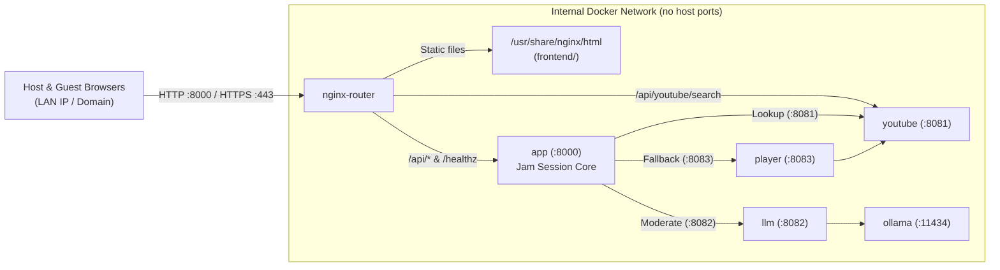

# Nginx Router / Reverse Proxy Plan

This document captures the plan for adding an **Nginx reverse proxy and router** in front of the Music Jam Docker services so all traffic enters through a single gateway while keeping internal bounded-context microservices unexposed on the host network.

---

## 1. Architecture Overview

Currently, `musicjam-app` (`:8000`) serves static frontend files and proxies requests to the bounded-context services, while `youtube` (`:8081`), `llm` (`:8082`), and `player` (`:8083`) also publish ports on the host.

With an **Nginx router**:
- **Only Nginx** publishes a host port (e.g. `0.0.0.0:8000:80` for local LAN use, or `:80` / `:443` in production).
- Static files (`frontend/`) can be served directly by Nginx with compression and cache headers.
- Public read-only search requests (`/api/youtube/search`) can route directly to `youtube:8081/search`, while session-authenticated Jam Session Core endpoints (`/api/room/*`, `/api/session`, `/api/genres`, `/api/player/fallback`) route to `app:8000`.
- Forwarding headers (`X-Forwarded-Host`, `X-Forwarded-Proto`, `X-Real-IP`) preserve the client's LAN IP or domain so `getJoinOrigin` in [`backend/main.go`](../backend/main.go) generates accurate QR codes.



---

## 2. Planned `nginx/nginx.conf`

Create `nginx/nginx.conf`:

```nginx
events {
    worker_connections 1024;
}

http {
    include       /etc/nginx/mime.types;
    default_type  application/octet-stream;
    sendfile      on;
    gzip          on;
    gzip_types    text/plain text/css application/json application/javascript image/svg+xml;

    client_max_body_size 64k;

    server {
        listen 80;
        server_name _;

        # Static frontend
        root /usr/share/nginx/html;
        index index.html;

        # Route YouTube search directly to the Search Catalog bounded context
        location = /api/youtube/search {
            proxy_pass http://youtube:8081/search$is_args$args;
            proxy_http_version 1.1;
            proxy_set_header Host $http_host;
            proxy_set_header X-Real-IP $remote_addr;
            proxy_set_header X-Forwarded-For $proxy_add_x_forwarded_for;
            proxy_set_header X-Forwarded-Host $http_host;
            proxy_set_header X-Forwarded-Proto $scheme;
            proxy_read_timeout 12s;
        }

        # Route Jam Session Core & authenticated endpoints to the core Go service
        location /api/ {
            proxy_pass http://app:8000;
            proxy_http_version 1.1;
            proxy_set_header Host $http_host;
            proxy_set_header X-Real-IP $remote_addr;
            proxy_set_header X-Forwarded-For $proxy_add_x_forwarded_for;
            proxy_set_header X-Forwarded-Host $http_host;
            proxy_set_header X-Forwarded-Proto $scheme;
            proxy_read_timeout 15s;
        }

        location = /healthz {
            proxy_pass http://app:8000/healthz;
        }

        location / {
            try_files $uri $uri/ =404;
        }
    }
}
```

---

## 3. Planned [`docker-compose.yml`](../docker-compose.yml) Changes

1. **Add the `nginx` router service** as the single published entry point:
   ```yaml
   services:
     nginx:
       image: nginx:1.27-alpine
       container_name: musicjam-router
       ports:
         - "0.0.0.0:8000:80"
       volumes:
         - ./nginx/nginx.conf:/etc/nginx/nginx.conf:ro
         - ./frontend:/usr/share/nginx/html:ro
       depends_on:
         - app
         - youtube
       networks:
         - gateway-net
       restart: unless-stopped
   ```
2. **Remove published `ports:` from internal services** (`app`, `youtube`, `player`, `llm`), keeping them accessible only inside Docker networks (`gateway-net`, `backend-net`, `llm-net`):
   - `gateway-net`: `nginx`, `app`, `youtube`
   - `backend-net` (`internal: true` optional if no external API needed; note `youtube` needs outbound internet for `googleapis.com`): `app`, `youtube`, `player`, `llm`
   - `llm-net`: `llm`, `ollama`
3. **Optional HTTPS Upgrade (Production / Public Hosting):**
   - Mount TLS certificates (or use Let's Encrypt / Certbot) on port `443` in `nginx`, redirect port `80` to `443`, and enable `Secure: true` on the `userId` cookie when `X-Forwarded-Proto: https` is present.

---

## 4. Verification Steps When Implemented

1. Start the stack: `docker compose up --build -d`
2. Confirm only port `8000` is bound on the host (`8081`, `8082`, `8083` are no longer directly reachable from outside Docker).
3. Open `http://<YOUR_LAN_IP>:8000` on the host machine, create a room, and verify:
   - Static pages and assets load through Nginx.
   - QR code encodes `http://<YOUR_LAN_IP>:8000/join.html?code=<uuid>` via `X-Forwarded-Host`.
   - `/api/youtube/search`, `/api/room/requests`, and `/api/room/skip` work end to end for host and mobile guests.
