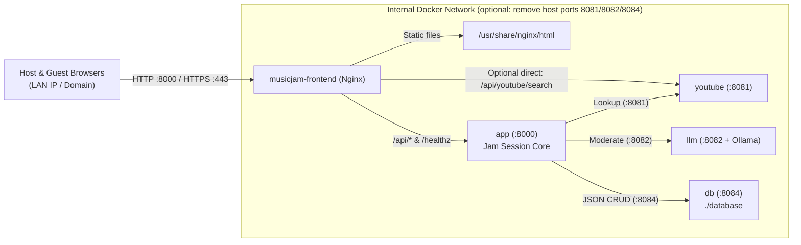

# Nginx Router / Reverse Proxy Enhancements

[`frontend/nginx.conf`](../frontend/nginx.conf) already runs Nginx inside `musicjam-frontend` (`:8000 -> :80`) to serve static files and proxy `/api/*` and `/healthz` to `musicjam-app` (`app:8000`).

This note documents optional future routing & hardening enhancements on top of that setup.

---

## 1. Current vs. Enhanced Routing

---

## 2. Optional Next Enhancements

1. **Direct `/api/youtube/search` routing in [`frontend/nginx.conf`](../frontend/nginx.conf):**
   Add an exact `location = /api/youtube/search` block before `location /api/` so search requests go straight to `http://youtube:8081/search$is_args$args` without passing through `app:8000`.
2. **Isolate internal microservices (`youtube`, `llm`, `db`):**
   Remove `ports:` from `youtube`, `llm`, and `db` in [`docker-compose.yml`](../docker-compose.yml) and split networks (`frontend-net` for `frontend` + `app`, `backend-net` for `app` + `youtube` + `llm` + `db`) so only `musicjam-frontend` is reachable from the host.
3. **HTTPS / TLS Termination:**
   Mount TLS certificates on port `443` in Nginx, redirect `80 -> 443`, and set `PUBLIC_ORIGIN=https://<your-domain>` so YouTube embeds and `Secure` cookies work in public deployments.
