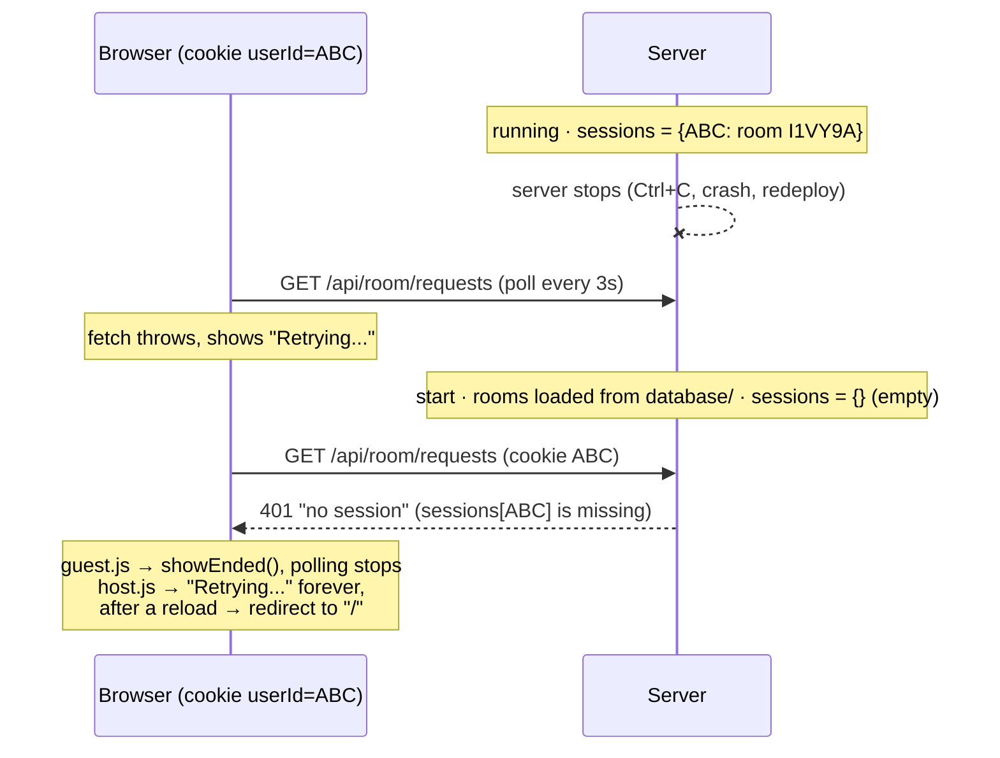

# Session lost after a server restart

**Problem:** If the backend goes offline and starts again, hosts and guests get thrown out of their jam. Rooms come back, because `LoadExistingRoomsFromDatabase` restores them from `database/room_*.json`, but **nobody can get back into them**.

**Short answer:** the `userId` cookie is **not** deleted. The browser still has it. The **server forgets what the cookie means**, because the `sessions` map only lives in RAM and is never saved. The frontend then reads that `401` as "you were removed" and ends the jam for good.

---

## 1. Why it happens

### 1.1 What survives a restart today

| Data | Where it lives | Survives a restart? |
|---|---|---|
| Rooms (code, host, members, queue, genre) | `rooms` map + `database/room_<CODE>.json` | ✅ loaded in [`main.go`](../backend/main.go) |
| Which room a user is in (`userId → Session`) | `sessions` map in [`main.go`](../backend/main.go) (RAM only) | ❌ **empty after every start** |
| Who the user is (`userId` cookie) | The browser | ✅ server restart · ❌ often when a phone closes the browser (no `MaxAge`, see 1.4) |

### 1.2 Step by step



1. The browser sends `userId=ABC` exactly as before.
2. [`currentCaller`](../backend/handlers.go#L52-L69) and [`getSession`](../backend/handlers.go#L192-L211) look up `sessions[c.Value]`. The map is empty, so they answer **`401 no session`**.
3. Frontend reaction:
   - [`guest.js` `refresh()`](../frontend/js/guest.js#L26-L49): `401` → `showEnded()` → `clearInterval(poll)`. The guest sees "jam ended" and **never polls again**, even though the room exists.
   - [`host.js` `refresh()`](../frontend/js/host.js#L61-L82): `!response.ok` → "Could not refresh queue. Retrying..." forever. After a reload, [`init()`](../frontend/js/host.js#L33-L58) gets `401` from `/api/session` → `location.href = "/"`. The host lands on the start page and can only create a **new** room.
   - [`session.html`](../frontend/session.html#L53-L62) and [`guest.js` `init()`](../frontend/js/guest.js#L14-L24): same, they redirect to the join page.

To the user this looks like "my session cookie was deleted". It wasn't: the server simply no longer knows the cookie.

### 1.3 The frontend can't tell "offline" from "removed"

- **While offline**, `fetch` throws a `TypeError`. `refresh()` catches it, which is fine. But `init()` in `guest.js`, `host.js`, `session.html` and `initQueue()` in `youtube-search.js` call `await fetch("/api/session")` **without** `try/catch`. If the page is opened or reloaded while the server is down, the promise rejects and the page **stays broken** (no polling, no retry) until the user reloads by hand.
- A reverse proxy (Render, Railway, nginx) answers `502/503` during a redeploy. `host.js` treats that like any other error, `guest.js` too, but neither keeps a "reconnecting" state.
- "Could not refresh queue. Retrying..." is **never cleared** after a successful poll (`#search-status` in guest, `#playback-status` in host).
- `401`/`404` is treated as "the jam is over". That is correct, **but only if the server really kept its sessions**. Today a restart produces the same `401`, so the frontend makes the wrong decision with correct logic.

### 1.4 The cookie itself is fragile too

[`getUserID`](../backend/handlers.go#L31-L41) sets the cookie without `MaxAge`/`Expires`. That makes it a *browser-session cookie*: it is deleted when the browser is closed. Mobile browsers close tabs in the background all the time, so on phones the cookie really can disappear. It also has no `SameSite`, so the browser default applies.

### 1.5 Related persistence bugs found on the way

These make the restart worse even after sessions are fixed:

| # | Bug | Effect after a restart |
|---|---|---|
| a | `Member.UserID` has `json:"-"`, and [`LoadExistingRoomsFromDatabase`](../backend/room/room.go#L173-L220) doesn't copy the map key back into it | `RemoveMember` returns a member with `UserID == ""`. The kick in [`removeRoomMember`](../backend/handlers.go#L183-L185) deletes `sessions[""]`, so **a kicked guest keeps their session** |
| b | `next_request` is saved, but `Requests` is not | After the restart `nextRequest` is e.g. `3` but `Requests` is empty. `for room.nextRequest < len(room.Requests)` in [`moderation.go`](../backend/room/moderation.go#L46) skips the first new requests, so **new songs get stuck** until there are more requests than before |
| c | `saveToJsonFile` only runs in `NewRoom`, `AddMember` and `RemoveMember` | Queue changes (song added, song finished) and genre are **not saved**. After a restart the queue is from the last member change |
| d | The loader reads **every** `*.json` in `database/` | A future `sessions.json` in the same folder would be loaded as a room with code `""` |
| e | `database/room_I1VY9A.json` is committed to git | The files contain every user's secret cookie value (`host_id`, member keys). Anyone with repo access can act as those users |

---

## 2. Proposed solution

The real fix is in the **backend** (persist sessions). The **frontend** fix makes the downtime itself smooth and stops it from treating "offline" as "removed".

### 2.1 Backend: persist sessions (the root cause)

Save only `userId → roomCode`. Name and host flag are already stored on the room member, so they are rebuilt from there and never stored twice.

**Why not just rebuild sessions from the room members?** Old memberships are never removed. If Sam joins room A and later room B, Sam is a member of both. Only the session knows that B is the current room.

**`database/sessions.json`**

```json
{
  "version": 1,
  "sessions": {
    "YQD66C2K6QXQZPBI6AK5RC6PG4": "I1VY9A",
    "5MH44LBZM6UXBVFOXC4BOGG5NI": "I1VY9A"
  }
}
```

**New file `backend/sessions.go`**

```go
package main

import (
	"encoding/json"
	"log"
	"os"

	"github.com/FullStackKlerant/musicjam/backend/room"
)

const sessionsFile = "../database/sessions.json"

type sessionsJSON struct {
	Version  int               `json:"version"`
	Sessions map[string]string `json:"sessions"` // key: user ID, value: room code
}

// saveSessions writes userId → roomCode to disk (temp file + rename). Caller must hold mu.
func saveSessions() {
	data := sessionsJSON{Version: 1, Sessions: make(map[string]string, len(sessions))}
	for userID, s := range sessions {
		data.Sessions[userID] = s.RoomCode
	}
	fileData, err := json.MarshalIndent(data, "", "  ")
	if err != nil {
		log.Println("save sessions:", err)
		return
	}
	tmp := sessionsFile + ".tmp"
	if err := os.WriteFile(tmp, fileData, 0600); err != nil {
		log.Println("save sessions:", err)
		return
	}
	if err := os.Rename(tmp, sessionsFile); err != nil {
		log.Println("save sessions:", err)
	}
}

// loadSessions rebuilds the sessions from disk. Sessions whose room is gone,
// or whose user is no longer a member (kicked), are dropped.
func loadSessions(rooms map[string]*room.Room) map[string]*Session {
	loaded := map[string]*Session{}
	fileData, err := os.ReadFile(sessionsFile)
	if err != nil {
		return loaded // first start: no file yet
	}
	var data sessionsJSON
	if err := json.Unmarshal(fileData, &data); err != nil {
		log.Println("load sessions:", err)
		return loaded
	}
	for userID, code := range data.Sessions {
		rm := rooms[code]
		if rm == nil {
			continue
		}
		m, ok := rm.Member(userID)
		if !ok {
			continue
		}
		loaded[userID] = &Session{Name: m.Name, RoomCode: code, IsHost: rm.IsHost(userID)}
	}
	return loaded
}
```

**`backend/room/room.go`**

```go
// Member returns the member with the given secret user ID
func (room *Room) Member(userID string) (Member, bool) {
	m, ok := room.members[userID]
	return m, ok
}
```

In `LoadExistingRoomsFromDatabase` (fixes 1.5 a and d):

```go
// Only room files, sessions.json lives in the same folder
if entry.IsDir() || !strings.HasPrefix(entry.Name(), "room_") || filepath.Ext(entry.Name()) != ".json" {
	continue
}
// ...after json.Unmarshal:
if data.RoomCode == "" {
	continue
}
if data.Members == nil {
	data.Members = map[string]Member{}
}
// UserID has json:"-", the secret only survives as the map key
for userID, m := range data.Members {
	m.UserID = userID
	data.Members[userID] = m
}
```

**`backend/main.go`**

```go
rooms = room.LoadExistingRoomsFromDatabase("../database")
sessions = loadSessions(rooms)
```

**`backend/handlers.go`**: call `saveSessions()` after every change to `sessions`:

- `createNewRoom`, after `sessions[userID] = ...`
- `joinRoom`, after `sessions[userID] = ...`
- `removeRoomMember`, after `delete(sessions, removed.UserID)`

### 2.2 Backend: make the cookie survive closing the browser

In `getUserID`, set the cookie **every time** (not only when it is new), so the 24 hours start over whenever someone creates or joins:

```go
const cookieMaxAge = 24 * 60 * 60 // seconds

func setUserCookie(w http.ResponseWriter, id string) {
	http.SetCookie(w, &http.Cookie{
		Name: "userId", Value: id, Path: "/",
		HttpOnly: true, SameSite: http.SameSiteLaxMode, MaxAge: cookieMaxAge,
	})
}

func getUserID(w http.ResponseWriter, r *http.Request) string {
	id := ""
	if c, err := r.Cookie("userId"); err == nil {
		id = c.Value
	} else {
		id = rand.Text()
		for sessions[id] != nil {
			id = rand.Text()
		}
	}
	setUserCookie(w, id)
	return id
}
```

(Optional: also call `setUserCookie` in `getSession`, so an active guest never runs into the 24 hours.)

### 2.3 Frontend: get through the downtime

Rule: **only a real answer from the server (`401`/`404`) ends the jam.** A network error or a `5xx` means "server offline", so show "Reconnecting…" and keep polling.

**New file `frontend/js/connection.js`** (load it before the page scripts):

```js
// Helpers to tell "server offline" apart from real answers like 401.

// Thrown when the server can't be reached or a proxy answers 5xx during a restart
class OfflineError extends Error {}

// fetch that turns network errors and 5xx answers into an OfflineError
async function apiFetch(url, options) {
  let response;
  try {
    response = await fetch(url, options);
  } catch {
    throw new OfflineError("Server unreachable");
  }
  if (response.status >= 500) throw new OfflineError("Server error " + response.status);
  return response;
}

// Returns the session, or null if the server says there is none.
// While the server is offline it keeps retrying instead of giving up.
async function loadSession() {
  for (;;) {
    try {
      const response = await apiFetch("/api/session");
      setConnection(true);
      return response.ok ? await response.json() : null;
    } catch (error) {
      if (!(error instanceof OfflineError)) throw error;
      setConnection(false);
      await new Promise((resolve) => setTimeout(resolve, 3000));
    }
  }
}

// Connection light: the .dot in the header pill, grey with "Reconnecting…" while offline
function setConnection(online) {
  const status = document.getElementById("connection-status");
  if (!status) return;
  status.hidden = online;
  status.textContent = online ? "" : "Reconnecting…";
  document.querySelector(".dot")?.classList.toggle("offline", !online);
}
```

**`guest.js`**

```js
async function init() {
  const session = await loadSession();          // retries while offline
  if (session?.roomCode !== code) {
    location.href = "/?join=" + encodeURIComponent(code);
    return;
  }
  // ...unchanged
}

async function refresh() {
  if (refreshing) return;
  refreshing = true;
  const version = queueVersion;
  try {
    const response = await apiFetch("/api/room/requests");
    setConnection(true);
    if (response.status === 401 || response.status === 404) {
      showEnded();                              // really removed / room gone
      return;
    }
    if (!response.ok) throw new Error("Could not load queue.");
    // ...unchanged
  } catch (error) {
    if (error instanceof OfflineError) setConnection(false);  // keep polling
  } finally {
    refreshing = false;
  }
}
```

**`host.js`**: same pattern. Use `loadSession()` in `init()`, `apiFetch` in `refresh()`, call `setConnection(...)` instead of writing "Retrying..." into `#playback-status`, and handle `401`/`404` explicitly (today the host retries forever):

```js
if (response.status === 401 || response.status === 404) {
  playbackStatus.textContent = "This jam is no longer available.";
  location.href = "/";
  return;
}
```

**`session.html`** and **`youtube-search.js` `initQueue()`**: replace `await fetch("/api/session")` with `await loadSession()`.

**HTML**: add `<span id="connection-status" class="text-body-secondary small" hidden></span>` next to the `.dot` in the room pill of `guest.html`. `host.html` has no `.dot` yet, so add the status span (and optionally a dot) to its header. In `style.css`:

```css
.dot.offline { background: var(--bs-secondary); }
```

### 2.4 Housekeeping

- Add `database/` to `.gitignore` and remove the committed room file with `git rm --cached database/room_I1VY9A.json` (1.5 e).
- Save the room after queue and request changes too (1.5 c), and either persist `Requests` or reset `nextRequest` to `0` at load time (1.5 b).
- The handler tests call `saveToJsonFile` through `NewRoom`/`AddMember`, so they write into the real `../database` folder. Making the folder configurable (e.g. a `DATA_DIR` variable, see `KNOWLEDGE_BASE.md` A.7) lets tests use `t.TempDir()`.

---

## 3. How to verify

### Automated restart test (`backend/handlers_restart_test.go`)

1. Host creates room A, guest joins A, `mover` joins A and then a room B, host kicks a fourth user.
2. "Restart": reload `rooms` with `LoadExistingRoomsFromDatabase` and `sessions` with `loadSessions(rooms)`.
3. With the same cookies:
   - `GET /api/session` for the host → `200`, `isHost: true`, same room code.
   - Guest → `200`, same room.
   - `mover` → session points to room **B**.
   - Kicked user → `401`.

### Manual check

1. `cd backend && go run .`, create a room, join as a guest from a private window.
2. Press Ctrl+C. Both pages show **"Reconnecting…"**, the guest page does **not** show "jam ended".
3. Reload the guest page while the server is down: it waits and retries instead of breaking.
4. `go run .` again. Within 3 seconds both pages carry on in the same room and the indicator turns green.
5. Kick the guest, restart again: the guest stays out (`401` → "jam ended").
6. Close and reopen the phone browser: still in the room (cookie `MaxAge`).
