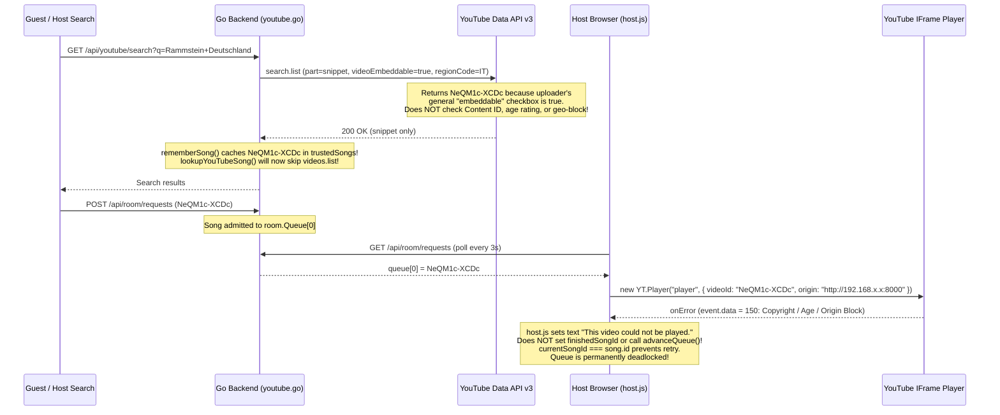
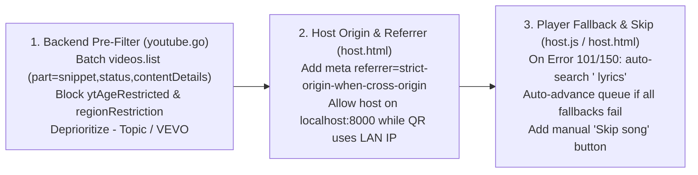

# YouTube Player & Copyrighted Music: Root-Cause Analysis and Workarounds

**Problem:** While royalty-free, classical, or children's videos (such as *The Best of Mozart* or *LooLoo Kids*) play without issue on the Music Jam host screen, **commercial copyrighted songs** (official music videos from VEVO / major record labels, `" - Topic"` auto-generated tracks, and age-restricted music videos) frequently fail with `"This video could not be played."` and **permanently freeze the room's playback queue**.

**Short answer:** There is not just one bug—three separate layers interact to cause this failure:
1. **YouTube Platform & Copyright Layer:** Major music labels (Universal, Sony, Warner, VEVO) and YouTube's Content ID system block external IFrame playback (`Error 150` / `101`), reject age-restricted videos in embeds (`Error 150`), and enforce strict HTTP `Referer` / `Origin` checks (`Error 150` / `153`) that fail when the host opens the app over a raw private LAN IP (`http://192.168.x.x:8000`) without an explicit referrer policy.
2. **Backend Search & Verification Layer ([`backend/youtube.go`](../backend/youtube.go)):** YouTube's `videoEmbeddable=true` search filter and `status.embeddable` flag **only** check the uploader's general checkbox—they do **not** check Content ID syndication locks, territorial restrictions (`contentDetails.regionRestriction`), or age restrictions (`contentDetails.contentRating.ytRating`). Worse, `handleYouTubeSearch` caches every search result as "trusted" immediately, bypassing `lookupYouTubeSong` completely.
3. **Frontend Queue State Machine Layer ([`frontend/js/host.js`](../frontend/js/host.js)):** When `YT.Player` fires `onError`, `host.js` displays `"This video could not be played."` and stops. It neither tries an alternative upload (e.g., a lyrics/audio version) nor advances the queue (`DELETE /api/room/queue`), and [`frontend/host.html`](../frontend/host.html) provides no **"Skip song"** button. The broken song remains stuck at `queue[0]` on disk (`database/room_<uuid>.json`), bricking the room.

---

## 1. Evidence from Recent Room Sessions (`database/`)

Inspecting the persisted room files in [`database/`](../database) shows the exact pattern of songs that succeeded versus those that stalled the player:

| Room File | Song & Channel | Video ID | Outcome in Host Player | Why It Happened |
| :--- | :--- | :--- | :--- | :--- |
| [`room_4278e91f...json`](../database/room_4278e91f-fcc5-408c-a66e-0e2b0be8b41c.json) | *The Best of Mozart* — `HALIDONMUSIC` | `Rb0UmrCXxVA` | ✅ Played | Independent classical label; no VEVO/major-label Content ID embed block. |
| [`room_4278e91f...json`](../database/room_4278e91f-fcc5-408c-a66e-0e2b0be8b41c.json) | *Johny Johny Yes Papa* — `LooLoo Kids` | `F4tHL8reNCs` | ✅ Played | Children's channel; unrestricted external embedding. |
| [`room_1040677c...json`](../database/room_1040677c-033f-4edb-9516-0cdeef1e0a38.json) | *rockstar* — `Post Malone - Topic` | `AaxFIY-cWH0` | ❌ Stuck at `queue[0]` | Auto-generated YouTube Music **"Art Track"** (`- Topic`, UMG/Republic Records). Subject to territorial & external-embed Content ID restrictions (`Error 150`). |
| [`room_1040677c...json`](../database/room_1040677c-033f-4edb-9516-0cdeef1e0a38.json) | *Eine weiße Rose* — `Universal Music Austria` | `QCo-Vf4qJ6Y` | ⏳ Blocked behind `queue[0]` | Universal Music Group upload; never even reached because `queue[0]` deadlocked the queue. |
| [`room_4278e91f...json`](../database/room_4278e91f-fcc5-408c-a66e-0e2b0be8b41c.json) | *BAND4BAND (MUSIC VIDEO)* — `Central Cee` | `pDddlvCfTiw` | ❌ Blocked (`Error 150`) | Official music video (Columbia / Sony Music) with external embed/referrer restrictions. Guests subsequently tried requesting *BAND4BAND (Lyrics)* (`7clouds`, `zoz2ORjru_w`) and *Mockingbird (Lyrics)* (`Dan Music`, `37V3b39_EXw`) as manual workarounds. |
| [`room_3da5bae3...json`](../database/room_3da5bae3-8865-43ae-9d54-a1d43b74be26.json) | *Rammstein - Deutschland (Official Video)* — `Rammstein Official` | `NeQM1c-XCDc` | ❌ Stuck at `queue[0]` | **Age-restricted** (`ytAgeRestricted`) + Universal Music Group copyright policy. YouTube blocks 100% of age-restricted videos in embedded players (`Error 150`). |

---

## 2. Detailed Root-Cause Analysis: What Is Wrong & Why



### 2.1 Cause 1: YouTube's Copyright, Syndication & `Origin`/`Referer` Enforcement

When the host page embeds a video via `https://www.youtube.com/iframe_api`, YouTube's embed server runs multiple checks that only apply to **copyrighted music (`videoCategoryId=10`)**:

1. **Content ID & Record Label Domain Blocks (`Error 150` / `101`):**
   - Major music rightsholders (Universal Music Group, Sony Music Entertainment, Warner Music Group, VEVO) manage rights through YouTube's **Content ID** system rather than standard creator settings.
   - Even when a video's `status.embeddable` property is `true` in the YouTube Data API, the rightsholder's Content ID policy can block playback inside third-party `<iframe>` embeds (so views stay on `youtube.com` or the YouTube Music app where full ad/subscription revenue is captured).
   - When blocked, the IFrame player fires `onError` with error code **`150`** (or **`101`**, which YouTube documentation defines as identical to `150`: *"The owner of the requested video does not allow it to be played in embedded players"*).

2. **Private LAN IP (`http://192.168.x.x:8000`) & Missing `Referer` Header (`Error 150` / `153`):**
   - In [`frontend/js/host.js`](../frontend/js/host.js#L58-L73), the app warns the host if they are on `localhost` and instructs them to open the page via their private LAN IP (`http://192.168.x.x:8000`). It then initializes the player with:
     ```js
     // frontend/js/host.js:207-209
     player = new YT.Player("player", {
       videoId: song.videoId,
       playerVars: { playsinline: 1, origin: location.origin },
     ```
   - For **copyrighted music videos**, YouTube requires valid client identity verification via the HTTP `Referer` header and the `origin` parameter.
   - [`frontend/host.html`](../frontend/host.html#L1-L10) does **not** declare `<meta name="referrer" content="strict-origin-when-cross-origin">`. When a browser loads an `http://192.168.x.x:8000` page (an unencrypted RFC 1918 private network address—not a W3C Secure Context like `http://localhost` or `https://...`), strict browser privacy settings, ad blockers, or cross-origin policies can strip or downgrade the `Referer` header sent to `https://www.youtube.com/embed/...`, or YouTube's VEVO/partner rights server rejects the unverified raw private IP origin (`http://192.168.x.x:8000`).
   - Crucially, YouTube **only** enforces this strict `Referer`/origin check on partnered/copyrighted music videos—non-copyrighted videos (like *The Best of Mozart*) continue playing even when the origin or referrer fails partner verification.

3. **Age-Restricted Music Videos (`ytAgeRestricted` → `Error 150`):**
   - Many official music videos (e.g., *Rammstein - Deutschland* [`NeQM1c-XCDc`], explicit hip-hop videos) carry a YouTube age restriction (`contentDetails.contentRating.ytRating == "ytAgeRestricted"`).
   - YouTube **unconditionally blocks all age-restricted videos in embedded players** on third-party sites (even if the user is signed into a verified adult Google account in the same browser), always returning `Error 150`.

4. **Auto-Generated `" - Topic"` Art Tracks (`Error 150`):**
   - Channels ending in `" - Topic"` (such as `Post Malone - Topic` [`AaxFIY-cWH0`]) are auto-generated by YouTube Music from distributor metadata (DistroKid, UMG, SME).
   - These tracks have strict country-by-country licensing (`contentDetails.regionRestriction`) and are frequently blocked from external non-YouTube-Music embedding.

---

### 2.2 Cause 2: Flaws in Backend Search & Metadata Verification ([`backend/youtube.go`](../backend/youtube.go))

1. **`videoEmbeddable=true` and `videoSyndicated=true` Are Not Enough ([`backend/youtube.go#L60-L70`](../backend/youtube.go#L60-L70)):**
   ```go
   searchURL := "https://www.googleapis.com/youtube/v3/search?" + url.Values{
       "part":            {"snippet"},
       "type":            {"video"},
       "videoCategoryId": {"10"},
       "videoEmbeddable": {"true"},
       "videoSyndicated": {"true"},
       "regionCode":      {regionCode},
       "maxResults":      {"5"},
       "q":               {query},
       "key":             {apiKey},
   }.Encode()
   ```
   - `videoEmbeddable=true` only checks whether the uploader left the *"Allow embedding"* checkbox ticked in YouTube Studio. It does **not** filter out videos blocked by Content ID policies, VEVO domain rules, or age restrictions.
   - `videoSyndicated=true` only checks whether the video can play on mobile devices/TVs outside `youtube.com` in general, not whether third-party web `<iframe>` embedding is permitted by the record label.

2. **`regionCode` in `search.list` Does NOT Filter Geo-Blocked Videos ([`backend/youtube.go#L55-L67`](../backend/youtube.go#L55-L67)):**
   - According to the YouTube Data API v3 specification, the `regionCode` parameter in `search.list` only *biases search ranking* toward videos popular in that country (default `"IT"`). It **still returns videos that are geo-blocked in that country**.
   - Actual regional blocks are only exposed in `videos.list` under `contentDetails.regionRestriction.allowed` and `contentDetails.regionRestriction.blocked`, which `backend/youtube.go` never requests.

3. **`rememberSong` Poisons the `trustedSongs` Cache and Bypasses `videos.list` ([`backend/youtube.go#L103-L136`](../backend/youtube.go#L103-L136)):**
   - Inside `handleYouTubeSearch`, every search result from `search.list` (`part=snippet`) is immediately stored in `trustedSongs`:
     ```go
     // backend/youtube.go:103
     rememberSong(room.Song{VideoID: item.ID.VideoID, Title: item.Snippet.Title, Channel: item.Snippet.ChannelTitle})
     ```
   - Seconds later, when the user clicks **"Request song"**, `lookupYouTubeSong` checks `trustedSongs` first:
     ```go
     // backend/youtube.go:131-136
     trustedSongMu.Lock()
     cached, ok := trustedSongs[videoID]
     trustedSongMu.Unlock()
     if ok && time.Now().Before(cached.expires) {
         return cached.song, nil
     }
     ```
   - Because the song is already in `trustedSongs` (with a 30-minute TTL), **`lookupYouTubeSong` never calls `videos.list` at all** for any song found via search! And even when `lookupYouTubeSong` *is* called for an uncached video ([`backend/youtube.go#L141-L170`](../backend/youtube.go#L141-L170)), it only requests `part=snippet,status` and never checks `contentDetails` (`regionRestriction` or `contentRating.ytRating`).

---

### 2.3 Cause 3: Frontend Queue Deadlock When `onError` Fires ([`frontend/js/host.js`](../frontend/js/host.js))

Even if a single unplayable video slips into the queue, a resilient music player should either fall back to an alternative audio stream or skip the broken track. Instead, [`frontend/js/host.js`](../frontend/js/host.js) enters an **unrecoverable deadlock**:

1. **`onError` Does Not Advance or Reset Playback State ([`frontend/js/host.js#L237-L239`](../frontend/js/host.js#L237-L239)):**
   ```js
   // frontend/js/host.js:219-239
   onStateChange: (event) => {
     if (event.target !== player || !currentSongId) return;
     if (event.data === YT.PlayerState.PLAYING) {
       started = true;
       playingSongId = currentSongId;
       startButton.hidden = true;
     }
     if (event.data === YT.PlayerState.ENDED && playingSongId === currentSongId) {
       playingSongId = "";
       finishedSongId = currentSongId;
       advanceQueue();
     }
   },
   // ...
   onError: () => {
     playbackStatus.textContent = "This video could not be played.";
   },
   ```
   - When YouTube blocks a copyrighted song (`onError` codes `100`, `101`, `150`), `YT.PlayerState.PLAYING` and `YT.PlayerState.ENDED` **never fire**.
   - Therefore, `playingSongId` remains `""`, `finishedSongId` remains `""`, and `advanceQueue()` is **never called**.

2. **`syncPlayer()` Permanently Ignores the Queue ([`frontend/js/host.js#L164-L193`](../frontend/js/host.js#L164-L193)):**
   ```js
   // frontend/js/host.js:183-188
   if (finishedSongId === song.id) {
     advanceQueue();
     return;
   }
   if (!apiReady || song.id === currentSongId || (player && !playerReady)) return;
   currentSongId = song.id;
   ```
   - Before calling `playSong(song)`, `syncPlayer()` sets `currentSongId = song.id`.
   - On every subsequent 3-second poll (`refresh()` → `updateQueue()` → `syncPlayer()`), `song.id === currentSongId` evaluates to `true`, so `syncPlayer()` returns early on line 187.
   - Even if the host reloads the browser tab or restarts the Go server, `queue[0]` is loaded right back from `database/room_<uuid>.json` ([`backend/room/room.go#L226-L311`](../backend/room/room.go#L226-L311)), immediately triggering the exact same error and locking the room again.

3. **No Manual "Skip Song" Button in [`frontend/host.html`](../frontend/host.html#L41-L51):**
   - The backend already supports removing the current song via `DELETE /api/room/queue` with `{"songId": "..."}` ([`backend/handlers.go#L255-L276`](../backend/handlers.go#L255-L276)), and only checks `rm.Queue[0].ID == finished.SongID`.
   - However, the host UI only renders `<button id="start-playback">Start playback</button>` and has no button for the host to manually skip a broken or unwanted song.

---

## 3. Recommended Workarounds & Solutions

Because YouTube's copyright restrictions are enforced externally by record labels, the best results come from combining **4 complementary workarounds**:
1. **Workaround 1 (Frontend Origin & Referrer Fix):** Stop YouTube from rejecting the host's embed origin (`Error 150` / `153`).
2. **Workaround 2 (Frontend Automatic Fallback + Auto-Skip + Manual Skip):** When an official music video is blocked (`Error 101` / `150`), automatically search for and play the **Lyrics / Audio** upload of the same song, and auto-advance (or let the host skip) if all candidates fail.
3. **Workaround 3 (Backend `videos.list` Pre-Filtering):** Filter out age-restricted (`ytAgeRestricted`), geo-blocked (`regionRestriction`), and non-embeddable videos before they ever appear in search results.
4. **Workaround 4 (Alternative Playback Providers / Architectures):** Options if 100% playback of all commercial tracks without YouTube IFrame limitations is required.

---

### Workaround 1: Fix Host Referrer Policy & Origin (`localhost` vs. LAN IP)

#### 1.1 Add Strict Referrer Policy in [`frontend/host.html`](../frontend/host.html)
YouTube's embedded player requires the embedding page to send a valid `Referer` header when requesting copyrighted music videos. Add `<meta name="referrer" content="strict-origin-when-cross-origin">` to `<head>` in [`frontend/host.html`](../frontend/host.html#L3-L10):

```html
<!-- frontend/host.html -->
<head>
  <meta charset="utf-8">
  <meta name="viewport" content="width=device-width, initial-scale=1">
  <meta name="referrer" content="strict-origin-when-cross-origin">
  <title>Music Jam – Host</title>
```

#### 1.2 Let the Host Use `http://localhost:8000` (While Guests Use the LAN IP QR Code)

Because **only the host browser** embeds the YouTube IFrame player (guests only use the web UI to search and submit song requests to the Go API), the host and guests do **not** need to open the app on the same URL origin:

- **How it already works in the backend & frontend:**
  - The Go server binds to `:8000` across all network interfaces ([`backend/main.go#L42-L48`](../backend/main.go#L42-L48)), so both `http://localhost:8000` and `http://<YOUR_LAN_IP>:8000` reach the same server.
  - `GET /api/session` ([`backend/handlers.go#L233-L240`](../backend/handlers.go#L233-L240)) returns `"joinOrigin": getJoinOrigin()` ([`backend/main.go#L102-L107`](../backend/main.go#L102-L107)), and [`frontend/js/host.js#L58-L60`](../frontend/js/host.js#L58-L60) uses `session.joinOrigin`—not `location.origin`—to build the QR code URL.
- **How to run with `localhost` on the host and LAN IP on guest phones:**
  1. **Running natively (`go run .`):** Leave `PUBLIC_ORIGIN` unset. `getJoinOrigin()` automatically resolves `GetLocalIP()` ([`backend/main.go#L91-L100`](../backend/main.go#L91-L100)). Open **`http://localhost:8000`** on the host laptop; the QR code will still encode `http://<YOUR_LAN_IP>:8000/join.html?code=...` for guests on Wi-Fi.
  2. **Running with Docker Compose ([`docker-compose.yml`](../docker-compose.yml#L5-L13)):** Inside a container, `GetLocalIP()` sees the internal Docker bridge IP (`172.x.x.x`), so `docker-compose.yml` defaults `PUBLIC_ORIGIN` to `http://localhost:8000` (which also triggers the `#localhost-warning` banner in [`frontend/js/host.js#L64-L72`](../frontend/js/host.js#L64-L72) and puts `localhost` in the QR code). To split host and guest origins in Docker, set `PUBLIC_ORIGIN=http://<YOUR_LAN_IP>:8000` in `.env` (so phones scan your laptop's real Wi-Fi IP) while opening **`http://localhost:8000`** in the host laptop's browser.
- **What `localhost` solves (and what it does *not* solve alone):**
  - **What it fixes:** Browsers and YouTube treat `http://localhost:8000` as a W3C **Secure Context** and trusted local development origin, resolving failures caused by serving `playerVars.origin` from an unencrypted private IP (`http://192.168.x.x:8000`, `Error 150` / `153`).
  - **What it does *not* fix by itself:** Switching the host back to `localhost` alone will **not** unblock every commercial track. You still need the remaining fixes below (or an architectural alternative in [Workaround 4](#workaround-4-alternative-playback-architectures-beyond-the-standard-youtube-iframe)):
    - **Referrer header ([Workaround 1.1](#11-add-strict-referrer-policy-in-frontendhosthtml)):** Without `<meta name="referrer" content="strict-origin-when-cross-origin">` in [`frontend/host.html`](../frontend/host.html#L3-L10), partnered music embeds can still fail referrer verification.
    - **Content ID / VEVO / `- Topic` / Age-restricted blocks ([Workaround 2](#workaround-2-automatic-fallback-to-lyricsaudio-upload--auto-skip--skip-button-frontendjshostjs) & [Workaround 3](#workaround-3-pre-filter-age-restricted-geo-blocked--non-embeddable-videos-in-backendyoutubego)):** Many official VEVO music videos, `" - Topic"` art tracks, and 100% of `ytAgeRestricted` videos block third-party `<iframe>` playback regardless of origin (`localhost` or `https://`). You need `videos.list` pre-filtering in [`backend/youtube.go`](../backend/youtube.go#L60-L108) plus automatic fallback to embed-friendly Lyrics/Audio uploads and queue auto-skip in [`frontend/js/host.js`](../frontend/js/host.js#L237-L239) so a single blocked track never freezes the room.
- **Even better (HTTPS Tunnel / Public Domain):** Running a free tunnel (`cloudflared tunnel --url http://localhost:8000` or `ngrok http 8000`) with `PUBLIC_ORIGIN=https://<tunnel-domain>`, or deploying to Render/Railway (as planned in [`README.md`](../README.md#L15)), serves both host and guests over a public **`https://`** origin, satisfying QR code scanning and YouTube's partner origin verification simultaneously.

---

### Workaround 2: Automatic Fallback to Lyrics/Audio Upload + Auto-Skip & Skip Button ([`frontend/js/host.js`](../frontend/js/host.js))

#### Why Lyrics / Audio Uploads Work When Official Music Videos Fail
Look at [`database/room_4278e91f-fcc5-408c-a66e-0e2b0be8b41c.json`](../database/room_4278e91f-fcc5-408c-a66e-0e2b0be8b41c.json#L84-L107): when *CENTRAL CEE FT. LIL BABY - BAND4BAND (MUSIC VIDEO)* (`pDddlvCfTiw`) failed, guests searched for *Central Cee - BAND4BAND (Lyrics)* (`zoz2ORjru_w` by `7clouds`) and *Cotton Eye Joe - Rednex (Lyrics)* (`5Z0SSOwIIbA` by `Alternate` in [`room_65c34853...json`](../database/room_65c34853-16a8-4a7a-9c04-79b7a0a5abbb.json#L14-L16)).

Why do `(Lyrics)` videos play in embedded players when `(Official Music Video)` uploads of the **exact same copyrighted song** throw `Error 150`?
- **Official Music Videos (VEVO / Artist Channels)** are governed by **visual music video syndication policies**, which block external `<iframe>` embedding to protect music video premiere/monetization agreements.
- **Lyric videos (`7clouds`, `Dan Music`, `Alternate`, etc.)** are third-party videos claimed via **Content ID audio matching** (*"Monetize in all countries"* policy). Because the record label collects 100% of the ad revenue on that third-party upload without classifying it as an official VEVO music video, Content ID leaves external embedding **enabled**!

#### 2.1 Add a `"Skip song"` Button to [`frontend/host.html`](../frontend/host.html#L41-L50)
```html
<!-- frontend/host.html:41-50 -->
<div class="card mt-4">
  <div class="card-body p-4 d-flex flex-wrap align-items-center gap-3">
    <div class="flex-grow-1">
      <p class="label">Now playing</p>
      <h2 class="song-title mb-1" id="song-title">Nothing yet</h2>
      <p class="text-body-secondary mb-0" id="song-meta"></p>
    </div>
    <div class="d-flex gap-2">
      <button type="button" class="btn btn-primary px-4" id="start-playback" hidden>Start playback</button>
      <button type="button" class="btn btn-outline-secondary px-3" id="skip-song" hidden>Skip song</button>
    </div>
  </div>
</div>
```

#### 2.2 Implement Automatic Fallback Search + Auto-Skip in [`frontend/js/host.js`](../frontend/js/host.js)
When `onError` fires (`event.data` in `[100, 101, 150, 153]`):
1. `host.js` automatically queries `/api/youtube/search?q=<title> <channel> lyrics` to find an embed-friendly lyric/audio upload of the same song.
2. It tries up to 2 alternative `videoId`s that haven't been tried yet for `currentSongId`.
3. If an alternative plays, the song continues seamlessly without the host or guest doing anything!
4. If all alternatives also fail, `host.js` automatically sets `finishedSongId = currentSongId` and calls `advanceQueue()` after 2.5 seconds so the queue never deadlocks.

```js
// Additions to frontend/js/host.js
const skipButton = document.getElementById("skip-song");
let triedVideoIds = new Set();
let fallbackCandidates = [];
let searchingFallback = false;

// Inside syncPlayer(), when queue is empty:
// skipButton.hidden = true;

// Inside syncPlayer(), when starting a new song (before playSong(song)):
triedVideoIds = new Set([song.videoId]);
fallbackCandidates = [];
searchingFallback = false;
skipButton.hidden = false;

// Replace onError in new YT.Player(...) with:
onError: (event) => {
  handlePlayerError(event.data);
},

async function handlePlayerError(errorCode) {
  const song = latestQueue[0];
  if (!song || song.id !== currentSongId) return;

  // Error 101 and 150 indicate copyright / embed restrictions; 100 = removed/private
  console.warn(`YouTube Player error ${errorCode} for video ${song.videoId} (${song.title})`);

  // 1. If we haven't searched for a Lyrics/Audio fallback for this song yet, fetch candidates
  if (!searchingFallback && fallbackCandidates.length === 0 && triedVideoIds.size === 1) {
    searchingFallback = true;
    playbackStatus.textContent = "Official video restricted by copyright — looking for a playable audio/lyrics version…";
    try {
      const cleanTitle = song.title.replace(/\(official.*?\)|\[official.*?\]/gi, "").trim();
      const cleanChannel = song.channel.replace(/- Topic$/i, "").replace(/VEVO$/i, "").trim();
      const query = `${cleanTitle} ${cleanChannel} lyrics`;
      const response = await fetchWithTimeout(
        "/api/youtube/search?q=" + encodeURIComponent(query),
        {},
        SEARCH_TIMEOUT_MS
      );
      if (response.ok) {
        const results = await response.json();
        fallbackCandidates = results
          .map((item) => item.videoId)
          .filter((id) => id && !triedVideoIds.has(id));
      }
    } catch {
      // Ignore fallback search failure and proceed to auto-skip
    } finally {
      searchingFallback = false;
    }
  }

  // 2. Try the next fallback candidate (up to 3 total attempts per song)
  while (fallbackCandidates.length > 0 && triedVideoIds.size < 3) {
    const nextVideoId = fallbackCandidates.shift();
    if (!triedVideoIds.has(nextVideoId)) {
      triedVideoIds.add(nextVideoId);
      playbackStatus.textContent = "Playing alternative lyrics/audio version…";
      if (started) {
        player.loadVideoById(nextVideoId);
      } else {
        player.cueVideoById(nextVideoId);
      }
      return;
    }
  }

  // 3. All fallbacks exhausted: auto-advance the queue so the room never deadlocks
  playbackStatus.textContent = "This song is blocked from embedded playback by its copyright holder. Skipping…";
  setTimeout(() => {
    if (latestQueue[0]?.id === currentSongId && !advancing) {
      playingSongId = "";
      finishedSongId = currentSongId;
      advanceQueue();
    }
  }, 2500);
}

// Wire the manual Skip Song button
skipButton.addEventListener("click", () => {
  if (!currentSongId || advancing) return;
  playingSongId = "";
  finishedSongId = currentSongId;
  advanceQueue();
});
```

---

### Workaround 3: Pre-Filter Age-Restricted, Geo-Blocked & Non-Embeddable Videos in [`backend/youtube.go`](../backend/youtube.go)

#### Why `search.list` Needs a Follow-Up `videos.list` Call
| Quota & Filtering Aspect | Current Code (`search.list` only) | Proposed Code (`search.list` + batched `videos.list`) |
| :--- | :--- | :--- |
| **YouTube API Quota Cost** | **100 units** per search (`maxResults=5`) | **101 units** per search (`search.list` with `maxResults=10` costs 100 units + 1 batched `videos.list` call with `id=v1,v2,...` costs **1 unit**) |
| **Checks `status.embeddable`?** | Only search index hint | ✅ Verified live from `status.embeddable` |
| **Filters `ytAgeRestricted`?** | ❌ No (allows *Rammstein - Deutschland*) | ✅ Rejects `contentDetails.contentRating.ytRating == "ytAgeRestricted"` |
| **Filters Country Geo-Blocks?** | ❌ No (`regionCode` only ranks results) | ✅ Rejects videos blocked in `regionCode` via `contentDetails.regionRestriction` |
| **Handles `- Topic` / VEVO blocks?** | ❌ Returns them first | ✅ Deprioritizes `- Topic` and `VEVO` channels below embed-friendly audio/lyric uploads |

#### Concrete Implementation for [`backend/youtube.go`](../backend/youtube.go)

```go
// backend/youtube.go: helper to check if a video from videos.list is truly playable in an embed
type youtubeVideoDetails struct {
	ID      string `json:"id"`
	Snippet struct {
		Title        string `json:"title"`
		ChannelTitle string `json:"channelTitle"`
		Thumbnails   struct {
			Default struct {
				URL string `json:"url"`
			} `json:"default"`
		} `json:"thumbnails"`
	} `json:"snippet"`
	Status struct {
		UploadStatus  string `json:"uploadStatus"`
		PrivacyStatus string `json:"privacyStatus"`
		Embeddable    bool   `json:"embeddable"`
	} `json:"status"`
	ContentDetails struct {
		RegionRestriction *struct {
			Allowed []string `json:"allowed"`
			Blocked []string `json:"blocked"`
		} `json:"regionRestriction"`
		ContentRating struct {
			YtRating string `json:"ytRating"`
		} `json:"contentRating"`
	} `json:"contentDetails"`
}

func isPlayableInRegion(v youtubeVideoDetails, regionCode string) bool {
	if !v.Status.Embeddable || v.Snippet.Title == "" {
		return false
	}
	if v.Status.PrivacyStatus != "" && v.Status.PrivacyStatus != "public" && v.Status.PrivacyStatus != "unlisted" {
		return false
	}
	// 1. Age-restricted videos ALWAYS fail with Error 150 in embedded players
	if v.ContentDetails.ContentRating.YtRating == "ytAgeRestricted" {
		return false
	}
	// 2. Check territorial copyright blocks (contentDetails.regionRestriction)
	if rr := v.ContentDetails.RegionRestriction; rr != nil && regionCode != "" {
		for _, blocked := range rr.Blocked {
			if strings.EqualFold(blocked, regionCode) {
				return false
			}
		}
		if len(rr.Allowed) > 0 {
			allowedHere := false
			for _, allowed := range rr.Allowed {
				if strings.EqualFold(allowed, regionCode) {
					allowedHere = true
					break
				}
			}
			if !allowedHere {
				return false
			}
		}
	}
	return true
}
```

In `handleYouTubeSearch` ([`backend/youtube.go#L42-L108`](../backend/youtube.go#L42-L108)):
1. Request `"maxResults": {"10"}` from `search.list` (same 100-unit quota cost).
2. Join the returned video IDs (`strings.Join(ids, ",")`) and call `https://www.googleapis.com/youtube/v3/videos?part=snippet,status,contentDetails&id=...` (costs only **1 quota unit**).
3. Filter out any video where `isPlayableInRegion(item, regionCode)` is `false`.
4. Sort results so that channels ending in `"- Topic"` or `"VEVO"` (which frequently carry unadvertised Content ID domain locks) appear *after* standard embeddable uploads, and return the top 5.
5. Update `lookupYouTubeSong` ([`backend/youtube.go#L130-L175`](../backend/youtube.go#L130-L175)) to request `part=snippet,status,contentDetails` and validate `isPlayableInRegion` as well.

---

### Workaround 4: Alternative Playback Architectures (Beyond the Standard YouTube IFrame)

If the project requires playing 100% of commercial tracks without relying on YouTube's official `<iframe>` embed policies, there are three architectural alternatives to consider, each with distinct legal/ToS and technical trade-offs:

| Approach | How It Works | Pros | Cons / Constraints |
| :--- | :--- | :--- | :--- |
| **Option 4A: Backend Audio Stream Extraction (`yt-dlp` + HTML5 `<audio>`)** | The Go backend runs `yt-dlp -f bestaudio -g <videoId>` (or proxies the audio stream through an endpoint like `GET /api/stream?v=<videoId>`) and the host plays it in a native `<audio>` tag instead of `YT.Player`. | • Plays **100%** of copyrighted, VEVO, `- Topic`, and age-restricted tracks.<br/>• Works on any LAN IP (`192.168.x.x`) without `Referer`/`Origin` issues.<br/>• Supports background audio on mobile/laptops. | • **Violates YouTube API Terms of Service** (noted in [`README.md`](../README.md#L23): *"The player has to stay visible, and extracting the audio is not allowed by YouTube's terms"*).<br/>• Cloud hosting IPs (Render/Railway) are frequently blocked/CAPTCHA'd by YouTube when running `yt-dlp`. |
| **Option 4B: Invidious / Piped Embed or API Fallback** | When `YT.Player` fires `onError(150)`, replace the iframe `src` with a public or self-hosted [Piped](https://github.com/TeamPiped/Piped) / [Invidious](https://github.com/iv-org/invidious) embed (`https://piped.video/embed/<videoId>?autoplay=1`) or fetch the stream URL from its API. | • Same `videoId` catalog as YouTube.<br/>• Bypasses VEVO/embed domain restrictions and age-gates in the browser. | • Public Invidious/Piped instances have variable uptime.<br/>• Still subject to YouTube's anti-scraping measures and ToS constraints. |
| **Option 4C: Spotify Web Playback SDK / SoundCloud Widget API** | Host logs in once with Spotify Premium on the host device; guests remain account-free and search via the backend's Spotify Client Credentials API. Playback uses the official Spotify Web Playback SDK. | • **100% legal and ToS-compliant**.<br/>• Every commercial copyrighted song plays reliably with high audio quality and zero video-embed blocks. | • Requires the **host** (not guests) to have an active Spotify Premium account.<br/>• Requires migrating or dual-supporting Spotify track IDs alongside YouTube video IDs. |

---

## 4. Summary Action Plan for Music Jam

To resolve the issue **while staying 100% compliant with YouTube's Terms of Service** ([`README.md`](../README.md#L23)), implement Workarounds 1, 2, and 3 together:



| Step | File(s) to Change | What It Solves | Effort |
| :--- | :--- | :--- | :--- |
| **Step 1** | [`frontend/host.html`](../frontend/host.html) | Add `<meta name="referrer" content="strict-origin-when-cross-origin">` and a `<button id="skip-song">Skip song</button>` next to `#start-playback`. | **10 min** |
| **Step 2** | [`frontend/js/host.js`](../frontend/js/host.js) | Handle `onError` (`100`/`101`/`150`) by automatically searching `/api/youtube/search?q=<title> <channel> lyrics` and loading the first untried `videoId`; if all fail, set `finishedSongId = currentSongId` and call `advanceQueue()` so the queue never freezes. Wire `#skip-song` to `advanceQueue()`. | **30 min** |
| **Step 3** | [`backend/youtube.go`](../backend/youtube.go) | Fetch `maxResults=10` in `search.list`, batch-verify with `videos.list` (`part=snippet,status,contentDetails`, +1 quota unit), filter out `ytAgeRestricted` and `regionRestriction` blocks, and deprioritize `- Topic` / `VEVO` videos below embeddable audio/lyric uploads. | **45 min** |
| **Step 4** | [`frontend/js/host.js`](../frontend/js/host.js#L64-L72) | Update the `localhost` note so the host knows they **can** host on `http://localhost:8000` (which YouTube trusts as a Secure Context) while `session.joinOrigin` automatically puts the `http://192.168.x.x:8000` LAN URL into the QR code for mobile guests. | **5 min** |
