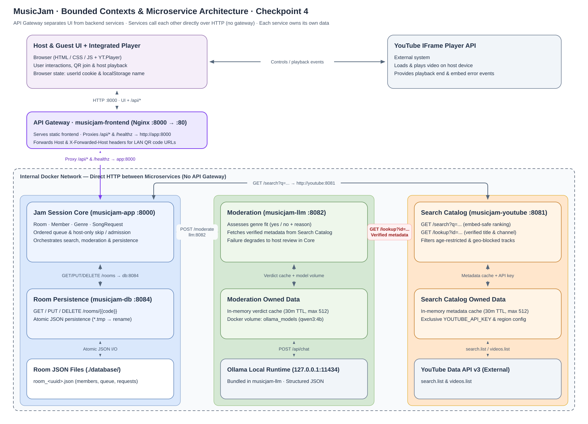
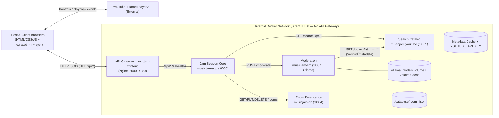
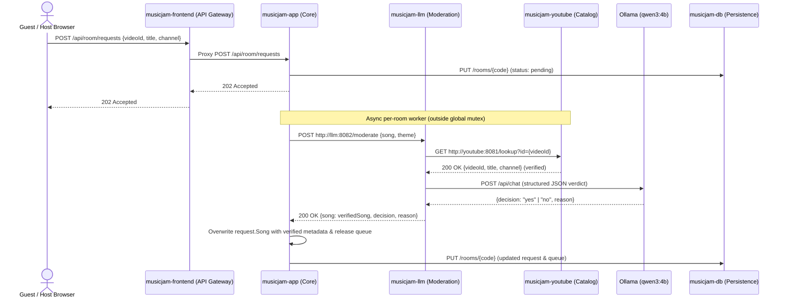

# MusicJam — Checkpoint 4 Documentation

This document captures the **Checkpoint 4** microservice architecture, updated Bounded Context Map, API Gateway routing, per-service data isolation, and direct microservice-to-microservice dependency for MusicJam.

---

## 1. Checkpoint 4 Requirements Checklist

| Requirement | Implementation in MusicJam | Evidence |
| :--- | :--- | :--- |
| **Updated Context Map & Bounded Contexts** | Refined from Checkpoint 3 to reflect the 5-container architecture: UI + API Gateway, Jam Session Core, Room Persistence, Search Catalog, and Moderation (with direct Moderation → Search Catalog lookup). | [`musicjam-bounded-contexts.drawio`](./musicjam-bounded-contexts.drawio) · [`musicjam-bounded-contexts.drawio.svg`](./musicjam-bounded-contexts.drawio.svg) |
| **Own microservice subdirectory & `Dockerfile` per Bounded Context** | Each backend Bounded Context has its own directory, independent Go module (`go.mod` — Go `net/http` is used as the service runtime instead of Node.js), and dedicated `Dockerfile`. Frontend + API Gateway live in `frontend/` with Nginx. | [`frontend/Dockerfile`](../../frontend/Dockerfile) · [`Dockerfile`](../../Dockerfile) · [`backend/Database/Dockerfile`](../../backend/Database/Dockerfile) · [`backend/YouTube/Dockerfile`](../../backend/YouTube/Dockerfile) · [`backend/LLM/Dockerfile`](../../backend/LLM/Dockerfile) |
| **Root `docker-compose.yml`** | Orchestrates all 5 services (`frontend`, `app`, `youtube`, `llm`, `db`) and shared volumes so the full system starts with `docker compose up --build`. | [`docker-compose.yml`](../../docker-compose.yml) |
| **API Gateway between UI and Backend Services** | `musicjam-frontend` (Nginx on `:8000 → :80`) serves the static UI and acts as the API Gateway for all browser `/api/*` and `/healthz` requests. **Backend services never route inter-service calls through the API Gateway** — they call each other directly over Docker's internal DNS (`http://app:8000`, `http://youtube:8081`, `http://llm:8082`, `http://db:8084`). | [`frontend/nginx.conf`](../../frontend/nginx.conf) · [`frontend/js/api.js`](../../frontend/js/api.js) |
| **Per-service data ownership (split storage)** | Persistent room JSON files live exclusively behind `musicjam-db` (`./database/room_<uuid>.json`), YouTube metadata cache & `YOUTUBE_API_KEY` live exclusively in `musicjam-youtube`, and LLM verdict cache & `ollama_models` (`qwen3:4b`) live exclusively in `musicjam-llm`. | [`backend/Database/main.go`](../../backend/Database/main.go) · [`backend/YouTube/main.go`](../../backend/YouTube/main.go) · [`backend/LLM/main.go`](../../backend/LLM/main.go) |
| **Direct Microservice-to-Microservice Dependency** | **`musicjam-llm` → `musicjam-youtube`**: During moderation (`POST /moderate`), `musicjam-llm` calls `GET http://youtube:8081/lookup?id=<videoId>` directly to obtain verified `title` and `channel` metadata before classifying the track with Ollama. | [`backend/LLM/main.go`](../../backend/LLM/main.go) · [`docker-compose.yml`](../../docker-compose.yml) |

> [!NOTE]
> **Runtime Choice (Go + Nginx):** Rather than Node.js, all backend microservices in this project are written in **Go (`net/http`)** with separate `go.mod` modules and multi-stage Dockerfiles per bounded context, paired with **Nginx** as the static UI host and API Gateway.

---

## 2. Updated Context Map (Checkpoint 3 → Checkpoint 4)



Editable source: [`musicjam-bounded-contexts.drawio`](./musicjam-bounded-contexts.drawio)

### Evolution since Checkpoint 3

1. **API Gateway introduced (`musicjam-frontend`):** Browser traffic enters exclusively through Nginx on port `8000`, which serves static assets and proxies `/api/*` and `/healthz` into the internal Docker network (`http://app:8000`).
2. **Integrated YouTube Player folded into Browser UI & Core:** Playback control lives in [`frontend/js/player.js`](../../frontend/js/player.js) and [`frontend/js/host.js`](../../frontend/js/host.js), calling Core's host-only `POST /api/room/skip` and `DELETE /api/room/queue` endpoints via the API Gateway.
3. **Room Persistence split into its own microservice (`musicjam-db`):** `musicjam-app` no longer mounts `./database` directly in Docker; it persists and restores `room_<uuid>.json` snapshots over HTTP (`GET/PUT/DELETE /rooms`) via `DB_URL=http://db:8084`.
4. **Direct dependency `Moderation → Search Catalog` (`musicjam-llm` → `musicjam-youtube`):** Instead of trusting client-submitted titles or asking `musicjam-app` to pre-fetch metadata, `musicjam-llm` directly requests authoritative song metadata from `musicjam-youtube` (`GET /lookup?id=...`) before invoking Ollama.

---

## 3. Architecture & Gateway Flow



### Gateway vs. Inter-Service Rules

- **UI → Gateway only:** All browser JavaScript calls in [`frontend/js/api.js`](../../frontend/js/api.js) use relative `/api/...` paths handled by `musicjam-frontend` (Nginx). Direct `/api/youtube/search → youtube:8081` routing in Nginx is documented as a future optimization in [`documentation/NGINX_ROUTER_PLAN.md`](../NGINX_ROUTER_PLAN.md).
- **No Gateway between services:** `musicjam-app`, `musicjam-llm`, `musicjam-youtube`, and `musicjam-db` communicate strictly via Docker internal service names (`app`, `youtube`, `llm`, `db`) over plain HTTP.

---

## 4. Microservice Inventory & Data Ownership

| Microservice | Bounded Context | Directory & Module | `Dockerfile` | Port | Owned Data / State | Direct Dependencies |
| :--- | :--- | :--- | :--- | :--- | :--- | :--- |
| **`musicjam-frontend`** | UI & API Gateway | `frontend/` (Nginx + Vanilla JS) | [`frontend/Dockerfile`](../../frontend/Dockerfile) | `8000 → 80` | Stateless (`userId` HttpOnly cookie & `localStorage` name live in browser) | Proxies `/api/*` & `/healthz` → `http://app:8000` |
| **`musicjam-app`** | Jam Session Core | `backend/` + `backend/room/` ([`go.mod`](../../backend/go.mod)) | [`Dockerfile`](../../Dockerfile) | `8000` (internal) | In-memory active room map & cookie sessions (hydrated from `db`) | `DB_URL=http://db:8084`, `YOUTUBE_URL=http://youtube:8081`, `LLM_URL=http://llm:8082` |
| **`musicjam-db`** | Room Persistence | `backend/Database/` ([`go.mod`](../../backend/Database/go.mod)) | [`backend/Database/Dockerfile`](../../backend/Database/Dockerfile) | `8084` | `./database/room_<uuid>.json` (rooms, members, queue, requests) | None (leaf persistence service) |
| **`musicjam-youtube`** | Search Catalog | `backend/YouTube/` ([`go.mod`](../../backend/YouTube/go.mod)) | [`backend/YouTube/Dockerfile`](../../backend/YouTube/Dockerfile) | `8081` | `YOUTUBE_API_KEY`, `YOUTUBE_REGION`, in-memory verified metadata cache (30m TTL, max 512) | External YouTube Data API v3 |
| **`musicjam-llm`** | Moderation | `backend/LLM/` ([`go.mod`](../../backend/LLM/go.mod)) | [`backend/LLM/Dockerfile`](../../backend/LLM/Dockerfile) | `8082` | `ollama_models` volume (`qwen3:4b`), in-memory verdict cache (30m TTL, max 512) | **`YOUTUBE_URL=http://youtube:8081` (`GET /lookup`)** + local Ollama (`127.0.0.1:11434`) |

---

## 5. Inter-Service Dependency Detail: `musicjam-llm` → `musicjam-youtube`

When a guest or host submits a song request in a genre-filtered room:



**Why this dependency exists & how it behaves:**
- **Anti-spoofing & authoritative metadata:** Clients cannot bypass genre moderation by submitting a fake title/channel for a different `videoId`; `musicjam-llm` always resolves canonical metadata from `musicjam-youtube` (`/lookup`) before prompting Ollama.
- **Resilient degradation:** If `musicjam-youtube` returns an error (or is unreachable) or Ollama fails, `musicjam-llm` returns `502 Bad Gateway` and `musicjam-app` safely places the request into `review` (`"AI check or YouTube verification unavailable. Host review required."`) so the host can decide manually without dropping requests or crashing the room.
- **`Any` genre short-circuit:** Rooms configured with genre `"Any"` skip moderation completely inside `musicjam-app` (and `musicjam-llm` also short-circuits `"Any"` without calling YouTube/Ollama).

---

## 6. Running & Verifying

### Start all services via Docker Compose

1. Create `.env` in the repository root with your YouTube Data API v3 key (and optional `HOST_IP` for LAN QR codes):
   ```env
   YOUTUBE_API_KEY=your-youtube-api-key
   # HOST_IP=192.168.1.42
   ```
2. Build and start all 5 containers:
   ```bash
   docker compose up --build -d
   ```
3. Open `http://localhost:8000` (or `http://<HOST_IP>:8000` for phones on your LAN) to interact with the UI through the Nginx API Gateway.

### Run automated unit tests (all Go modules)

```bash
(cd backend && go test -race -v ./...) && \
(cd backend/LLM && go test -race -v ./...) && \
(cd backend/YouTube && go test -race -v ./...) && \
(cd backend/Database && go test -race -v ./...)
```
